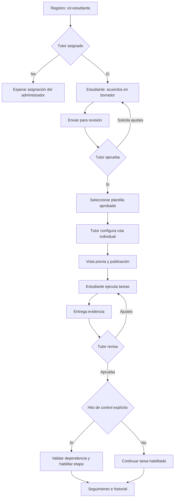

# 01 · PRD — MAGIC | Plataforma de Seguimiento Académico de Posgrados

**Versión:** 7.0 · 17/11/2026  
**Estado:** especificación operativa reconstruida, no constancia de desarrollo/despliegue  
**Nombre del producto:** MAGIC.  
**Fuentes:** `07_Flujo_Completo_Plataforma_Seguimiento_Academico.md` (núcleo funcional), 14 maquetas Stitch + `DESIGN.md` (lenguaje visual), solicitud del 17/11/2026 (roles, entornos nuevos, despliegue y pruebas).

## 1. Visión y resultado

Sistema web de posgrado que coordina **estudiante → tutor/director → administrador** en un expediente académico trazable. Un estudiante registra acuerdos de primera conversación; su tutor vinculado los aprueba; el tutor selecciona una **ruta recomendada** como referencia, la ajusta por proyecto y publica; el estudiante realiza tareas y presenta evidencias; el tutor revisa y emite avales; solo los hitos configurados con exigencia expresa de aval pueden desbloquear la siguiente etapa. La plataforma no otorga títulos, notas ni certificaciones académicas por completar actividades.

**Pregunta estudiante:** «¿Qué debo hacer ahora, qué entregaré y qué está pendiente del tutor?»  
**Pregunta tutor:** «¿Qué estudiante necesita una decisión, qué debo aprobar y qué ruta le corresponde?»  
**Pregunta administrador:** «¿Quién accede, quién tutoriza a quién, qué acuerdos o entregas existen y cómo audito el servicio?»

### Objetivos verificables

1. Autenticación real, rol predeterminado `student` y asignación controlada de `tutor`/`admin`.
2. Cada expediente contiene su propio estudiante, tutor, acuerdos, versión publicada de ruta, tareas y entregas.
3. Aprobación y devolución de acuerdos con trazabilidad, antes de habilitar ejecución.
4. Plantillas académicas versionadas, rutas particulares editables por tutor y publicadas atómicamente.
5. Entregas versionadas con archivo/comentario; «enviada» nunca equivale a «aprobada».
6. Seguimiento responsive, con estados, siguiente acción, comentarios y auditoría real.
7. Supabase **nuevo y aislado**; repositorio GitHub **nuevo**; aplicación Vercel **nueva**, sin depender de instalaciones anteriores.
8. Evidencia automatizada de pruebas de integración y E2E después de desplegar, no mera comprobación visual.

## 2. Límites de alcance y autoridad

| Clase | Contenido | Decisión de implementación |
|---|---|---|
| CONFIRMADO por solicitud | tres experiencias, admin accede a las tres, nuevos usuarios estudiantes, solo admin asigna tutores/admins, proyecto nuevo en Supabase/GitHub/Vercel | Requisito obligatorio |
| NÚCLEO de flujo anexo | acuerdos → aval tutor → ruta recomendada/personalizada → publicación → tareas/evidencias → revisión → habilitación de hitos | Obligatorio |
| PROPUESTA coherente | estados de corrección, historial de evidencias, edición controlada de rutas publicadas, notificaciones internas, navegación contextual | Implementar bajo reglas explícitas aquí; confirmar antes de operar con datos reales |
| VISUAL no validado | comité colegiado, firma notarial, convenios, DOIs de muestra, rúbricas, 6 fases canónicas, porcentaje de riesgo, alertas, firmas por lote, exportaciones de cohorte | No afirmar operativo ni sembrar datos ficticios; componente oculto/deshabilitado hasta decisión formal |
| FUERA DE ALCANCE MVP | pagos, IA que decide tutores/avales, expedición automática de grados, firma criptográfica con valor jurídico, predictor de riesgo, acceso institucional SSO sin proveedor definido | No construir por defecto |

**Conflicto documental resuelto:** los seis documentos de ejemplo tratan de un producto antiguo (diamantes, umbrales, cartas); esta versión los reemplaza expresamente. **Conflicto visual resuelto:** el ZIP nuevo es oscuro/editorial, no el viejo tema marfil/teal.

## 3. Perfiles y permisos

| Capacidad | Estudiante | Tutor | Administrador |
|---|---|---|---|
| Registro abierto / iniciar sesión | Sí / sí | Cuenta provisionada / sí | Cuenta provisionada / sí |
| Ver su propio expediente, acuerdos, ruta y entregas | Sí | No como estudiante ajeno salvo tutoría asignada | Vista supervisora autorizada |
| Crear/corregir acuerdos propios | Sí, según estado | Consulta y dictamen en asignados | Supervisión, no aval suplantado |
| Elegir plantilla, ajustar/publicar ruta por tesista | No | Solo en asignados, tras acuerdos aprobados | Administrar catálogos; no «firmar como tutor» sin delegación formal |
| Presentar archivos y comentarios de tareas | Sí, solo su proyecto | Ver los de asignados | Lectura/auditoría con propósito autorizado |
| Aprobar/rechazar evidencias | No | Solo director vinculado | No, salvo política institucional específica |
| Gestión de cuentas/roles, bloqueo de cuentas y asignaciones | No | No | Sí |
| Alternar «vista estudiante/tutor/admin» | No | No; solo experiencia de tutor | Sí; acceso contextual autorizado y auditado |

**Tres experiencias, una sesión:** `student → /estudiante`; `tutor → /tutor`; `admin → /administracion`. El administrador puede acceder a los tres *espacios de interfaz* desde un selector de vista; hacerlo no convierte automáticamente al administrador en estudiante titular de otro expediente ni en tutor académico con capacidad de aval. Para ver un caso concreto se exige selección explícita y autorización y, por defecto, se usa modo **solo lectura** y evento de auditoría.

### Alta y cambio de rol

- Toda cuenta creada por **autorregistro normal** nace `student` desde un trigger/control de servidor, aun si el navegador pide otro rol.
- El primer `admin` se crea **una sola vez** por procedimiento de bootstrap exclusivo de entorno seguro, después de crear el proyecto Supabase nuevo. No existe una contraseña de administrador en SQL, HTML ni en Git.
- El panel `/administracion/usuarios` puede **crear un usuario tutor o administrador** ingresando email y contraseña temporal. La credencial se transmite únicamente por HTTPS a una función protegida que llama `supabase.auth.admin.createUser`; Supabase Auth gestiona el hash. Ni el administrador ni nuestra tabla `profiles` leen la contraseña.
- Preferencia de seguridad: invitación al correo (`inviteUserByEmail`) para fijar contraseña personalmente. Como el requisito pide contraseña introducida por admin, mantener opción controlada de **clave temporal de un solo uso**, forzar cambio inicial y no registrarla jamás.
- Si el correo ya está registrado como `student`, **no crear cuenta duplicada**: promover el perfil existente tras verificar identidad y autorización, auditando el cambio. No cambiar la contraseña de ese usuario sin un flujo expreso y seguro de restablecimiento.
- El perfil efectivo se consulta **en servidor/base al iniciar sesión y al intentar operaciones**; el próximo login del promovido lo dirige a su nueva vista. Una sesión antigua no debe conservar capacidades revocadas.
- Solo administradores autorizados pueden otorgar o retirar roles; impedir retirar el último administrador activo.

## 4. Módulos funcionales

| ID | Módulo | Función y prueba de salida | Prioridad |
|---|---|---|---|
| P01 | Acceso, registro y recuperación | email/password, validación, sesiones, rol por defecto, salida segura | P0 |
| P02 | Administración de usuarios y roles | crear/provisionar, promover, desactivar, asignar tutor, auditoría | P0 |
| P03 | Proyecto y tutoría | proyecto individual, tutor responsable, estado de vinculación | P0 |
| P04 | Acuerdos iniciales | borrador, envío, devolución, aval tutor, historial | P0 |
| P05 | Catálogo de rutas | plantilla aprobada + enfoque + origen/versión/fuentes verificables | P0, contenido institucional por definir |
| P06 | Editor de ruta y publicación | copiar plantilla, quitar/agregar/ordenar, preview, publicar una versión activa | P0 |
| P07 | Tareas, hitos y navegación del estudiante | sólo ruta publicada, estados y bloqueo condicionado | P0 |
| P08 | Evidencias y dictámenes | subida privada, entrega versionada, revisión y ajustes | P0 |
| P09 | Bandeja del tutor | acuerdos/evidencias pendientes, estudiantes asignados, perfil | P0 |
| P10 | Administración y trazabilidad | cohortes reales, estado de usuarios, asignaciones, auditoría | P1 |
| P11 | Bitácora de ideas/referencias | notas y referencias separadas de evidencias oficiales | P2 opcional |
| P12 | Comités, asesorías, actas y firma | potencial módulo colegiado de maquetas | P2 condicionado |
| P13 | Indicadores, riesgo y exportación | solo métricas aprobadas con fuentes y fórmula | P2 condicionado |

## 5. Reglas de negocio y estados

**Regla R01:** la primera acción del estudiante con tutor es redactar y enviar acuerdos; sin tutor, mostrar «Asignación pendiente».  
**R02:** `draft → submitted → approved | changes_requested` mediante operaciones transaccionales con actor y fecha.  
**R03:** solo tutor asignado aprueba; un estudiante no puede aprobar su propio envío.  
**R04:** acuerdos aprobados habilitan diseño de ruta, no ejecución inmediata: la ruta requiere estado `published`.  
**R05:** plantillas base nunca se modifican por personalización de un estudiante; se crea copia versionada.  
**R06:** editar ruta publicada con tareas entregadas exige estrategia de versiones (por defecto: crear revisión y conservar versiones/evidencias anteriores; no borrar entregas).  
**R07:** las tareas solo derivan de versión `published`, no de borradores.  
**R08:** `pending → in_progress → submitted → approved | changes_requested` con estado consistente de entrega.  
**R09:** para tareas que no requieren archivo, definir evidencia admitida o finalización documentada; no imponer subida a todo.  
**R10:** el desbloqueo utiliza `requires_approval` y dependencias explícitas establecidas por tutor/plantilla; no todas las fases bloquean por defecto.  
**R11:** repetir `submit`, `publish` o `approve` con la misma `idempotency_key` no duplica filas ni provoca estados contradictorios.  
**R12:** toda consulta sensible ajena al titular se audita; nunca usar perfiles ficticios en producción.

## 6. Flujo íntegro de valor

## 7. Criterios de aceptación principales

| Caso | Expectativa inequívoca |
|---|---|
| AC-01 | un autorregistro muestra `student` en DB y `/estudiante` tras iniciar sesión, independientemente del payload malicioso |
| AC-02 | tutor/promoción por admin se refleja tras nuevo login; otros estudiantes no pueden promoverse |
| AC-03 | un admin alterna las tres vistas pero un «ver como» no le permite firmar como el tutor de otro proyecto |
| AC-04 | usuario sin tutor vinculado no inicia acuerdos aprobables/ruta activa |
| AC-05 | acordar ≠ enviar ≠ aprobar; estado y timestamps son persistentes |
| AC-06 | tutor no ve expediente de estudiante no asignado por URL, API ni Storage |
| AC-07 | estudiante no ve ruta borrador y no puede ejecutar sin acuerdos aprobados + ruta publicada |
| AC-08 | publicar dos veces retorna la misma versión/efecto sin duplicar tareas |
| AC-09 | tutor reordena la copia, no cambia la plantilla canónica |
| AC-10 | una entrega nueva aparece `submitted` y en bandeja del tutor, NO `approved` |
| AC-11 | aval de hito aplica únicamente dependencia explícita; falta de aval bloquea la próxima etapa sólo donde corresponda |
| AC-12 | el historial conserva intentos y comentarios sin sobrescribir archivos |
| AC-13 | carga privada es inaccesible a tercero usando URL directa |
| AC-14 | móvil 360–430, tablet 768 y desktop 1024–1440 operan sin desbordes ni controles inaccesibles |
| AC-15 | después de desplegar, pruebas desde URL Vercel verifican escritura/lectura en proyecto Supabase nuevo |
| AC-16 | ningún documento confunde tareas finalizadas con aprobación institucional del grado |

## 8. Decisiones pendientes con dueño

| ID | Decisión institucional | Responsable sugerido | Impacto |
|---|---|---|---|
| D01 | quién crea un proyecto y asigna tutor; cambio de tutor | Administración académica | bloqueante para tutoría |
| D02 | campos obligatorios y doble conformidad de acuerdos | Dirección académica | bloqueante al cerrar acuerdos |
| D03 | enfoques, plantillas reales y referencias aprobadas | Dirección académica | bloqueante de publicación real |
| D04 | mínimos obligatorios e hitos de control por programa | Dirección académica | bloqueante para desbloqueos |
| D05 | formatos/tamaños de evidencia, retención y derechos de acceso | Institución / Seguridad | bloqueante para archivos reales |
| D06 | modificar ruta publicada con entregas existentes | Dirección académica | bloqueante para cambios postpublicación |
| D07 | nivel de acceso admin al expediente y consentimiento/avisos | Institución / Legal | bloqueante datos reales |
| D08 | alcance comité, rúbricas, firmas, alertas y estadísticas | Gestión académica | P2 |
| D09 | nomenclatura final de plataforma | Producto | no bloqueante técnica |
| D10 | verificación de correo, MFA admin, política de contraseñas | Seguridad | bloqueante salida producción |
| D11 | proceso de cierre formal académico | Institución | excluido hasta aprobar |

**No sustituir decisiones institucionales por datos ficticios de Stitch.**
