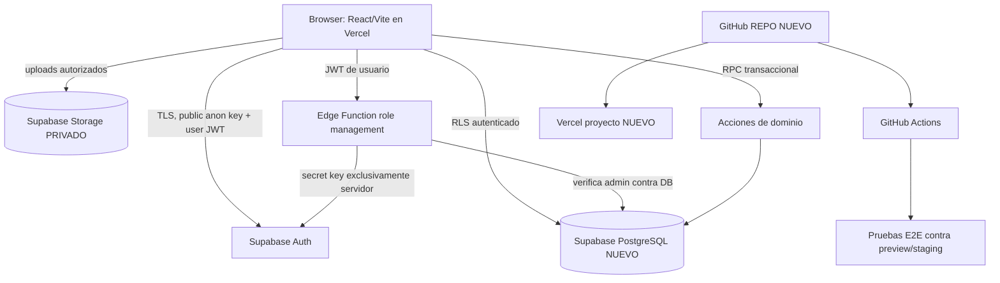

# 02 · TRD — MAGIC | Arquitectura técnica

**Versión:** 7.0 · 17/11/2026. **Estado:** diseño de implementación; nada de lo descrito confirma acceso real a cuentas o despliegues.  
**Fuente funcional:** 01 PRD + 07 Flujo Académico; **fuente visual:** Stitch «Posgrados & Investigación» (14 pantallas).

## 1. Decisión arquitectónica

**Recomendada:** SPA privada React 19.3 + Vite 8.3 + TypeScript; Tailwind CSS 4 + CSS nativo, Radix Primitives, Motion; Supabase nuevo (Auth, Postgres, Storage), Edge Functions/RPC para reglas críticas; Vercel para hosting, GitHub para cambios. No usar Next.js salvo necesidad real de SSR/SEO o procesos server-side no resueltos por funciones protegidas. El servicio trata datos académicos privados, por lo que rendimiento cliente y autorización son más relevantes que indexación SEO.

| Capa | Elección | Motivo | Rechazada de inicio |
|---|---|---|---|
| Runtime visual | React 19.3 estable + TypeScript | componentes, tabs, listas, estados compartidos | HTML Stitch como app final |
| Build | Vite 8.3 compatible; Node LTS soportado | velocidad, SPA y Vercel | versión fijada sin lockfile |
| CSS | Tailwind 4 CSS-first `@theme` + CSS Grid/Flex/container queries | identidad Stitch 1:1 y responsive | dos sistemas CSS paralelos |
| Motion | `motion/react` + CSS transitions | animación pequeña con reduced-motion | parallax forzado/GSAP duplicado |
| UI headless | Radix UI, Lucide opcional | foco, diálogo, tabs, accesibilidad | kit UI con tema ajeno |
| Formularios | React Hook Form + Zod | estados, validación cliente + servidor | validación cliente como única barrera |
| Datos React | `@tanstack/react-query` | cache/refetch, optimistic controlado | guardar en localStorage como fuente de verdad |
| Auth | `@supabase/supabase-js`, Supabase Auth | sign-in/up/invite/reset | contraseñas en tablas públicas |
| DB | PostgreSQL RLS + constraints + RPC | aislamiento, consistencia | seguridad solo por rutas React |
| Storage | bucket `academic-evidence` **privado** | archivos trazables y permisos | archivos públicos |
| Backend privilegiado | Supabase Edge Functions | provisionamiento/rol, URLs, RPC | `service_role` en frontend o VITE_ |
| Pruebas | Vitest, Testing Library, Playwright, supabase db tests | lógica, acceso cruzado, responsive | aceptación por captura aislada |
| Observabilidad | logs estructurados sin cuerpo sensible + eventos auditoría | detectar errores y operaciones críticas | registrar contraseñas o evidencias |

**Versiones:** confirmar versiones actuales y compatibilidad con npm antes de fijar lockfile. React 19.3 y rama Vite 8.3 están documentados oficialmente a noviembre de 2026; los releases patch se fijan en `package-lock.json` durante instalación.

## 2. Topología y límites de confianza



**Proyectos separados:** `supabase-project-id` distinto al existente; nueva cadena `VITE_SUPABASE_URL`, nueva publicable key, buckets/DB/usuarios desde cero; repo GitHub nuevo; proyecto Vercel nuevo enlazado solo al repo. Documentar IDs en `infra/environments.md` **sin claves secretas**. En preview usar preferentemente otro proyecto Supabase staging, nunca producción para pruebas destructivas.

## 3. Estructura del repositorio final (objetivo)

```text
/
  README.md
  package.json / package-lock.json / vite.config.ts / tsconfig*.json
  src/
    app/                  routes, role-router, session-provider, app-shell
    components/ui/        Button, Dialog, Tabs, Sidebar, Drawer, StatusChip, Toast
    features/auth/        login, register, recover, onboarding, change-password
    features/admin/       users, roles, invitations, tutor-assignments, audit
    features/student/     workspace, agreements, route, tasks, submissions, feedback
    features/tutor/       dashboard, inbox, agreements-review, route-builder, review
    features/academic/    templates, stages, steps, program-catalogs
    domain/               guards, statuses, transitions, permissions, validators
    data/                 supabase-client, repositories, typed-database, query-keys
    styles/               tokens.css, typography.css, print.css
    assets/                licensed visual assets only
  supabase/
    migrations/           SQL ordenado versionado
    functions/            manage-user, evidence-download, ...
    tests/                pgTAP / integration policies
  tests/e2e/              role, workflow, file, security, responsive
  .github/workflows/     quality.yml / deploy-gate.yml
  docs/                  01-07, ADRs, runbooks, QA matrix
  referencias_stitch/    design / HTML / screens solo como referencia
  .env.example            variables sin valores secretos
```

## 4. Máquina de acceso y RBAC

```ts
type AppRole = 'student' | 'tutor' | 'admin';
type ViewContext = 'student' | 'tutor' | 'admin';
// rol real: profiles.role devuelto por servidor y verificado otra vez en cada operación.
// preferred_view: preferencia UI, JAMÁS permiso.
```

- `on_auth_user_created`: crear `profiles(role='student')` sin aceptar `user_metadata.role`.
- Primera cuenta admin: `scripts/bootstrap-admin.mjs` ejecutado por operador con credenciales del proyecto **nuevo**. Condición de exclusividad: un token o gate de primer arranque autorizado, no una ruta HTTP pública `/bootstrap`.
- Gestión de roles: Edge Function verifica token JWT, consulta rol actual en DB fresca, rechaza no-admin, luego usa Auth Admin API en servidor. Para una cuenta existente promociona perfil transaccionalmente; para una nueva la crea con credencial temporal o invita; audita. Asegurar reconciliación si Auth crea usuario y falla segundo paso DB (compensación con estado pending).
- `role` efectivo consultado desde DB también en RLS, no confiar en JWT obsoleto ni metadatos autodeclarados; desactivar rol bloquea de inmediato nuevas consultas.
- Si administrador usa vista estudiante o tutor: pantalla de inspección contextual, **sin poder emitir avales como otro docente**. «Suplantación» real no es requisito y estaría prohibida salvo política formal.
- Cuenta existente promocionada: nuevo sign-in redirige según rol; en sesión activa se actualiza UI al refrescar/consultar, pero las autorizaciones de servidor siempre aplican.

## 5. Contratos de dominio, servicios y estados

| Operación | Entrada | Autoridad | Invariante |
|---|---|---|---|
| `registerStudent` | email/password | Auth | nunca crea admin/tutor |
| `adminProvisionUser` | email, role, credencial temporal o invite | Admin + Edge | auditoría y cero contraseña en tablas |
| `adminAssignTutor` | projectId, tutorId | Admin | tutor activo, relación única vigente |
| `saveAgreementsDraft` | projectId, version, campos | Student titular | solo editable en draft/changes_requested |
| `submitAgreements` | projectId, revision, requestKey | Student titular | no habilitar ruta, solo revisión |
| `decideAgreements` | agreementId, approve/changes, comment | Tutor vinculado | solo sobre submitted, no doble dictamen |
| `createRouteDraft` | projectId, templateVersionId | Tutor vinculado | acuerdos aprobados, plantilla inmutable |
| `editRouteDraft` | routeDraftId, items/orden, revision | Tutor vinculado | no editar version published |
| `publishRoute` | routeDraftId, requestKey | Tutor vinculado | 1 versión activa, tasks únicas, transaction |
| `submitEvidence` | taskId, objectKey, version, requestKey | Student titular | objeto pertenece al proyecto/tarea; submitted |
| `reviewEvidence` | submissionId, decision, comment | Tutor vinculado | solo pendiente, registra dictamen |
| `unlockNext` | task/hito | sistema dominio | solo dependencia explícita cumplida |

Todos los `projectId` recibidos del cliente se contrastan con pertenencia en SQL. `RLS` es barrera de datos; RPC transaccionales con `SECURITY DEFINER` si se justifica, `SET search_path`, `REVOKE EXECUTE FROM PUBLIC` y grants por función. No ejecutar aprobación crítica con dos `update()` independientes desde navegador.

### Estados canónicos

```text
project: awaiting_tutor | agreements | route_configuration | active | execution_finished
agreement: draft | submitted | changes_requested | approved
route_version: draft | published | superseded
stage: locked | available | in_progress | validated
academic_task: pending | in_progress | submitted | changes_requested | approved
submission: submitted | changes_requested | approved
user: active | disabled | pending_invite
```

Una tarea puede completarse sin archivo si la ruta lo permite; no usar un check local como aprobación tutorial. Estados derivados se calculan de manera única en servicio de dominio; UI solo representa.

## 6. Gestión de archivos

1. El estudiante solicita subida para tarea propia habilitada; backend crea metadatos de intención y objeto aleatorio asociado a `project_id` y `task_id`.
2. Cliente sube a bucket privado. **Nunca** usar un enlace público para evidencia, comentarios o actas.
3. Validación final verifica objeto existente, pertenencia y metadatos; confirmar `submission` en una operación idempotente.
4. Tutor asignado lee el documento por autorización a bucket o URL firmada corta expedida tras validación y auditada.
5. Al devolver, conservar entrega anterior y crear versión nueva; no sobrescribir la misma clave.
6. Recomendar límites iniciales **propuestos** (a ratificar): PDF, DOCX, PNG/JPEG; tamaño máximo ajustable por bucket, antivirus/escaneo cuando aplique, nombres internos UUID y nombre visible sanitizado.

## 7. Operación de rutas publicadas

Un borrador contiene `route_versions` + `route_stages` + `route_tasks`. Al publicar, transacción con bloqueo `SELECT ... FOR UPDATE` sobre `projects`, valida acuerdo aprobado y tutor vigente, desactiva/supersede versión anterior cuando corresponda y crea tareas activas *una sola vez*. Pide `request_key` exclusivo para no duplicar. **Si hay envíos en ruta anterior, nunca eliminar en cascada**: conservar versión histórica, mapear tareas continuadas o requerir aprobación del rediseño. MVP puede prohibir republicar después de la primera entrega hasta disponer política institucional.

## 8. Rutas privadas y UX por rol

```text
/acceso /registro /recuperar
/estudiante /estudiante/acuerdos /estudiante/ruta /estudiante/tareas/:id /estudiante/entregas
/tutor /tutor/pendientes /tutor/estudiantes/:id /tutor/rutas/:projectId/editar
/administracion /administracion/usuarios /administracion/asignaciones
/administracion/vista/estudiante/:projectId     # inspection read-only
/administracion/vista/tutor/:tutorId              # inspection read-only
```

Permisos repetidos en frontend (usabilidad), backend (operación) y RLS (datos). Las guardas React no son controles de seguridad suficientes.

## 9. Modelo operativo y observabilidad

- En cada solicitud, `request_id`, actor UUID, tipo de operación, target UUID, estado, hora UTC, causa de fallo sin texto académico.
- Errores de Auth sin exposición de existencia de correos en interfaces públicas; límites anti-abuso y verificación de email.
- Indicar «Guardando», «Guardado por servidor», «Error: reintentar»; no afirmar éxito por optimismo visual.
- Notificaciones en-app derivadas de eventos reales; email transaccional opcional, nunca sin política de remitente.
- Protección XSS en comentarios/HTML; permitir Markdown sanitizado solo si justifica.
- Recuperación y backups, rotación secrets, separación preview/prod y procedimiento de incidentes documentados.

## 10. Integración GitHub ↔ Vercel ↔ Supabase, con gate

| Gate | Procedimiento | Evidencia obligatoria |
|---|---|---|
| G0 | crear nuevos proyectos y repo, anotar IDs, comprobar que difieren de actuales | identificadores, sin secretos |
| G1 | migraciones `supabase db push` contra proyecto nuevo; RLS y bucket | logs migración, SQL assert |
| G2 | configurar Auth/redirect URLs y bootstrap primer admin | login real admin, perfil admin único autorizado |
| G3 | conectar repositorio nuevo a Vercel nuevo, variables públicas `VITE_...` | URL preview, commit SHA |
| G4 | conectar Edge Functions con secretos **solo server** | invocación admin rechaza usuario estudiante |
| G5 | ejecutar registro alumno, acceso, acuerdo, tutor, ruta, evidencia, aval desde URL Vercel | filas de DB comprobadas con ID y hora |
| G6 | probar RLS cruzado, Storage privado, pruebas E2E y móvil | reporte QA exportable |
| G7 | liberar producción únicamente con gate aprobado | acta técnica, rollback |

**No afirmar 100% conectado si no hay evidencia de G0–G7.** En runtime actual no hay conexiones externas autorizadas: la matriz sirve para ejecución futura, no una declaración de éxito.

## 11. Documentación y enlaces técnicos

- React 19.3: https://react.dev/blog/2026/09/09/react-19-3
- Vite 8: https://vite.dev/releases
- Tailwind: https://tailwindcss.com/docs/theme
- Motion reduced motion: https://motion.dev/docs/react-use-reduced-motion
- Supabase RLS: https://supabase.com/docs/guides/database/postgres/row-level-security
- Supabase Auth Admin: https://supabase.com/docs/guides/auth/users
- Vercel Vite: https://vercel.com/docs/frameworks/frontend/vite
- Vercel entornos: https://vercel.com/docs/deployments/environments
