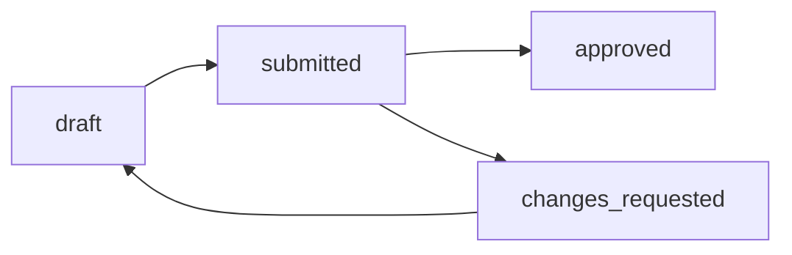
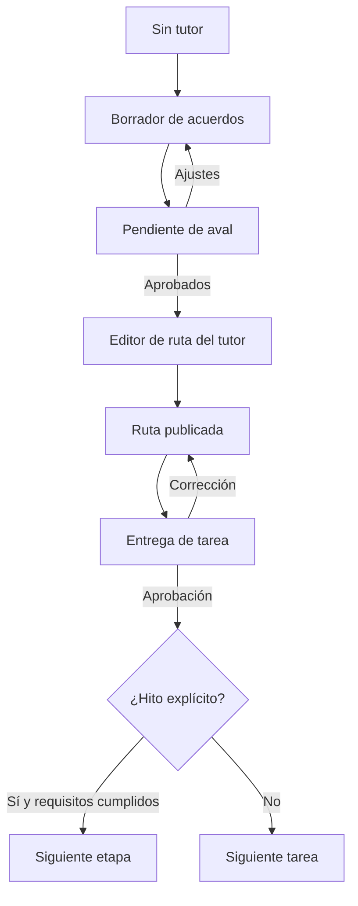

# 03 · App Flow — MAGIC | UX, roles y navegación académica

**Versión:** 7.0 · 17/11/2026. El flujo académico `07` gobierna, el ZIP determina el estilo, no los permisos ni los datos mostrados de ejemplo.

## 1. Arquitectura de información

**Público:** `/acceso`, `/registro`, `/recuperar` (una sola entrada y un solo registro; pestañas según Stitch).  
**Estudiante:** `Mi proyecto | Mis acuerdos | Mi ruta | Tareas y entregas | Historial`; `Comité/asesorías` y `Bitácora` únicamente cuando estén habilitados.  
**Tutor:** `Mis estudiantes | Por revisar | Acuerdos | Editor de rutas | Seguimiento`; catálogo de plantillas en consulta.  
**Administrador:** `Resumen | Usuarios y roles | Asignaciones | Expedientes | Plantillas | Auditoría | Cambiar vista`. El administrador es único que accede a los tres espacios visuales sin crear roles ficticios.

**Regla de enrutamiento:** login → obtener `profiles.role` desde servidor → `student` → `/estudiante`; `tutor` → `/tutor`; `admin` → `/administracion`. `preferred_view` puede cambiar dentro de admin; nunca modifica `profiles.role`.

## 2. Inventario de 14 maquetas Stitch (observadas en ZIP)

| Referencia exacta de carpeta | Rol/vista | Ajuste a realizar |
|---|---|---|
| `acceso_institucional_y_registro` | Pública desktop | login/registro reales sin contadores ficticios |
| `acceso_institucional_m_vil` | Pública móvil | mismo Auth, formularios y mensajes accesibles |
| `acuerdos_iniciales_y_formalizaci_n_c01` | Acuerdos desktop (maqueta de firma/revisión) | separar autor estudiante y aval tutor; no firma notarial ficticia |
| `acuerdos_iniciales_m_vil` | Acuerdos móvil | conservar matriz legible y CTA según rol real |
| `configurar_ruta_acad_mica_c02_c03_c06` | Tutor, ruta desktop | copiar plantilla, ordenar, editar, preview, publicar |
| `configurar_ruta_m_vil` | Tutor, ruta móvil | ordenar por botones, paneles apilados y publicar |
| `tutor_editor_de_ruta_por_tesista_c02_c03_c06` | Tutor, editor largo desktop | catálogo lateral + versión editable individual |
| `panel_de_cohorte_y_m_tricas_del_director_c07_c08` | Tutor, observatorio desktop | reales: pendientes y asignados; riesgos no aprobados se ocultan |
| `panel_de_cohorte_m_vil` | Tutor, observatorio móvil | lista y tarjetas, evita tablas anchas |
| `tutor_bandeja_de_decisiones_y_avales_c07_c08` | Tutor, revisión desktop | separar evidencia, dictamen y feedback, no firma masiva real |
| `estudiante_tareas_y_entregas_c04_c05_c09` | Estudiante, tareas y entregas desktop | hitos reales y archivos con estado backend |
| `mi_investigaci_n_y_tareas_c04_c05_c09` | Estudiante, tesis desktop compacta | próximo hito, microtareas, bitácora condicional |
| `mi_tesis_e_investigaci_n_m_vil` | Estudiante móvil | una acción por sección y estado de carga |
| `estudiante_comit_y_asesor_as` | Estudiante, comité | módulo de P2 condicionado; no afirmar actas ni comités reales |

**Faltan diseños explícitos:** panel de gestión de roles admin, selector admin de tres experiencias, pantalla de tutor sin estudiantes, alta tutor desde admin, errores RLS y conflicto de versión. Diseñarlos con mismos tokens, sin copiar pantallas falsas del ZIP.

## 3. Primer acceso: cuatro situaciones

1. **Registro abierto:** correo/clave/confirmación/aviso de privacidad → supabase signup → perfil `student` autogenerado. Si correo requiere confirmación, mostrar pantalla `Revisa tu correo`, no prometer sesión.
2. **Estudiante nuevo sin proyecto/tutor:** la portada explica «Aún no tienes un proyecto y tutor asignados»; admin crea/vincula el proyecto; nunca asigna tutor al azar.
3. **Cuenta creada por admin como tutor:** invitación o clave temporal segura → login → cambio de contraseña cuando aplica → vista tutor, inicialmente «Sin estudiantes asignados» si corresponde.
4. **Cuenta creada por admin como nuevo admin:** login → vista administración; posibilidad de alternar tres vistas, pero sin falsificar aprobación académica.

**Test UX-LOGIN:** cuenta estudiantil que envía `{role:'admin'}` en el registro sigue siendo estudiante; acceso directo a `/administracion` denegado. Promoción efectiva en nuevo login. Usuario desactivado no accede a datos.

## 4. Storyboard estudiante: V00–V18

| Paso | Pantalla / evento | Acciones del estudiante | Resultado visible |
|---|---|---|---|
| E01 | V00 Mi proyecto | consulta tutor y nombre del proyecto | CTA de acuerdos o aviso de vinculación pendiente |
| E02 | V02 Acuerdos | escribe fecha/temas/acuerdos/compromisos, guarda | `draft` con guardado validado |
| E03 | V02 Enviar | confirma envío | `submitted`, tutor recibe pendiente |
| E04 | V04 Espera | consulta estado | no se abre ejecución hasta aval |
| E05 | V04 Ajustes | lee observación y edita nueva revisión | historial conservado |
| E06 | V08 Ruta publicada | lee fases configuradas por tutor | próximo hito disponible y etapas bloqueadas justificadas |
| E07 | V09 Actividad | lee objetivo, instrucciones, requisitos | estado y CTA adecuado |
| E08 | V10 Depositar evidencia | elige archivo y comentario, confirma | `submitted` real y versión |
| E09 | V11 Seguimiento | revisa historial | `en revisión`, `aprobada` o `ajustes` |
| E10 | V14 Correcciones | carga nueva versión | anterior preservada, nuevo pendiente |
| E11 | V15 Hito aprobado | consulta la continuación | desbloqueo solo por dependencia exigible |
| E12 | V18 Fin de ruta | ve resumen de acciones | nunca «grado aprobado» sin proceso institucional |

**V01 orientación del tutor**, **V17 ideas/bitácora**, **comité/asesorías**: condicionales, no deben bloquear E01–E12.

## 5. Storyboard tutor: secuencia sin saltos

| Paso | Vista | Acción tutor | Resultado de datos |
|---|---|---|---|
| T01 | Mis estudiantes / cola | selecciona acuerdo de asignado | carga proyecto correcto |
| T02 | V03 Revisión de acuerdos | aprueba o pide corrección con comentario | registra dictamen y actor |
| T03 | V05 Ruta base | selecciona plantilla versionada institucional aprobada | lectura sin editar catálogo |
| T04 | V06 Editor de ruta | conservar/quitar/agregar/reordenar fases y tareas | copia privada en borrador, sin alterar plantilla |
| T05 | V07 Prepublicación | visualiza ruta como estudiante | advierte consecuencias de publicar |
| T06 | Publicar | confirma una única publicación | tareas de esa versión disponibles |
| T07 | V12 Mis estudiantes | consulta pendientes y progreso real | acciones contextualizadas |
| T08 | V13 Evidencia | abre archivo privado, deja comentario y dictamina | `approved` o `changes_requested` |
| T09 | V16 Expediente | consulta versiones e historial | sin mezclar otros estudiantes |

## 6. Storyboard administrador

- **A01 Bootstrap:** por canal operativo protegido se crea primer usuario admin en el proyecto nuevo; se valida inicio de sesión.
- **A02 Gestión:** ingresa `/administracion/usuarios` y registra correo + rol `tutor` o `admin`; puede añadir credencial temporal de un solo uso o invitar al correo. Si existe estudiante con ese correo, muestra la opción «Asignar nuevo rol a esta cuenta» tras confirmación y auditoría.
- **A03 Asignaciones:** vincula tutor activo con el proyecto/estudiante; queda histórico de cambios de tutor.
- **A04 Ver como:** menú `Administración | Vista tutor | Vista estudiante`; en las dos últimas la pantalla informa `Modo supervisión — solo lectura` y exige seleccionar expediente. El admin vuelve a su vista sin cambiar rol.
- **A05 Auditoría:** verifica quién creó/promovió, quién aprobó acuerdos y quién accedió a expedientes; no mostrar textos sensibles completos en logs.

## 7. Statecharts resumidos

## 8. Tratamiento de estados y casos excepcionales

| Condición | Microcopy | Comportamiento |
|---|---|---|
| sin tutor | «La asignación del tutor está pendiente» | no permitir avales |
| acuerdos en draft | «Tus acuerdos no se han enviado» | conservar edición |
| acuerdos submitted | «Tu tutor está revisando los acuerdos» | no habilitar ruta |
| ruta configurada sin publicar | «Tu tutor está preparando tu ruta» | estudiante no ve borrador |
| sin plantilla aprobada | «No hay ruta institucional aprobada para este enfoque» | no inventar fase estándar |
| evidencia submitted | «Entrega recibida; pendiente de revisión» | no marcar aprobada |
| aval correcciones | «El tutor solicitó ajustes: …» | nuevo intento versionado |
| hitos bloqueados | «Esta etapa requiere el aval de [actividad]» | botón deshabilitado con explicación |
| upload fallido | «No pudimos guardar tu archivo; reintenta» | no generar entrega |
| conflicto de revisión | «Cambió la información. Actualiza antes de guardar» | no sobrescribir |
| cuenta promovida | «Tu acceso fue actualizado. Inicia sesión nuevamente» | redirección según rol fresco |
| admin inspección | «Modo de supervisión; no puedes aprobar como tutor» | readonly |

## 9. UX responsive y accesibilidad

- Desktop ≥1200: sidebar 280–320px + canvas de lectura; tablet 768–1199: sidebar plegable + tarjetas 2 columnas solo si caben; móvil <768: navegación inferior contextual o menú, tarjetas apiladas y CTA visible.
- Tamaños de referencia 1440, 1280, 1024, 768, 430, 390, 360. La maqueta móvil exporta capturas muy estrechas; **rediseñar responsivamente** en lugar de reproducir píxeles como ancho fijo.
- Reordenación de fases: drag (desktop) + `Mover arriba/abajo` accesible; archivos mediante input teclado aunque haya drop zone.
- Confirmaciones, foco, error y `aria-live` de guardado; contraste verificable; sin interacciones exclusivas hover.
- Mantener paneles de documento en alto contraste tipo papel, dentro del entorno oscuro; lectura de textos largos sin recorte.

## 10. Evidencia de pruebas por viaje

`UX01` registro estudiante; `UX02` bootstrap admin; `UX03` admin crea tutor; `UX04` promoción existente; `UX05` tutor no asignado; `UX06` acuerdos borrador; `UX07` envío; `UX08` devolución; `UX09` aval; `UX10` editor de plantilla y copia; `UX11` publicación idempotente; `UX12` no visibilidad de borrador; `UX13` entrega y Storage; `UX14` aprobación; `UX15` hito condicionado; `UX16` admin alterna tres visuales sin suplantar; `UX17` acceso cruzado denegado; `UX18` móvil + teclado + reduced motion; `UX19` falla de red; `UX20` historial no ficticio.

**Nota de fuente:** los títulos «fases canónicas», «matriz vinculante», «dictamen colegiado» y los nombres de estudiantes de Stitch son ejemplos; no se publican como registros oficiales.
