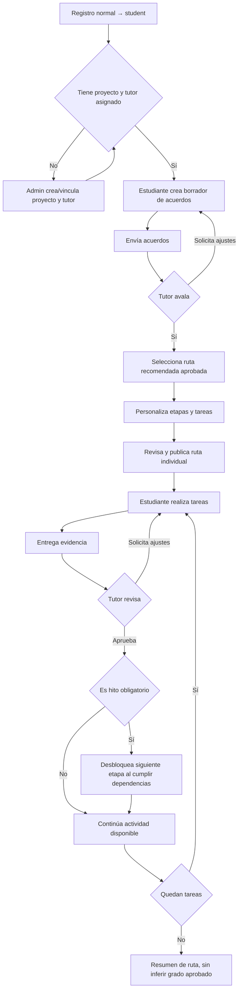

# 07 · Flujo completo actualizado — MAGIC | Seguimiento Académico de Posgrados

**Versión:** 7.0 · 17/11/2026  
**Propósito:** fuente funcional integral reconstruida, conservando el flujo de la reunión del 06/11/2026 y agregando únicamente la gobernanza de roles e infraestructura solicitada el 17/11/2026. Las 14 maquetas visuales son referencias de experiencia; detalles sin validación se identifican como PROPUESTA/CONDICIONAL.  
**Nombre del producto:** MAGIC.

## 1. Los tres espacios y el circuito central

**Estudiante:** sistema de tareas, acompañamiento y evidencias. Debe poder responder «dónde voy, qué hago, qué entrego y quién lo aprueba».  
**Tutor/director:** sistema de decisiones y personalización del itinerario de sus proyectos. Debe poder responder «qué tengo por aprobar y qué secuencia le corresponde a este tesista».  
**Administrador:** gobierna cuentas, permisos, asignaciones, catálogo aprobado, estadísticas sustentadas, expedientes y auditoría. Puede **visualizar los tres espacios**, pero no sustituir a un tutor para validar trabajo académico salvo política aprobada.

**Invariantes:** la aprobación del acuerdo antecede a la publicación de ruta; el estudiante no publica ruta; la entrega no es aval; la ruta es individual; el cierre formal de grado no está especificado.

## 2. Registros, roles y permisos

### 2.1 Registro público

Una persona crea cuenta desde `/registro` con correo y contraseña, acepta información de privacidad aplicable y verifica email si Auth lo requiere. Supabase la registra como `student` **sin excepción de client-side**. Si no tiene proyecto/tutor, la vista muestra estado de espera en lugar de un tutor ficticio.

### 2.2 Primer administrador

El primer admin solo puede crearse tras aprovisionar el **nuevo proyecto** Supabase y ejecutar procedimiento de bootstrap desde estación confiable con correo y secreto recibidos por variable protegida. No se introduce contraseña en SQL público ni archivos GitHub. El correo de la solicitud se configura en runtime, no se promociona automáticamente por una coincidencia de email que cualquiera pudiera registrar. Probar su sesión y cambiar clave temporal.

### 2.3 Nuevos tutores y administradores

El admin abre `/administracion/usuarios`, selecciona `tutor`/`admin`, escribe email y, si se usa el flujo solicitado, una contraseña temporal. Backend autorizado crea el Auth user y el perfil; alternativamente invita al correo para establecer la contraseña por cuenta propia. Si el email ya existe, la acción es **cambiar rol de cuenta validada**, sin duplicar identidad ni fijar contraseña ajena. El nuevo rol decide la ruta al **siguiente inicio de sesión**, no un botón decorativo.

### 2.4 Cambio de vista por admin

Menú de 3 espacios: «Administración», «Vista tutor», «Vista estudiante». Para vistas ajenas se elige una asignación existente y el sistema indica **Solo lectura / supervisión**. El administrador no falsifica firma, aval, entrega o autoría del estudiante. Su acceso a información ajena debe corresponder a finalidad informada y registro de auditoría.

## 3. Navegación y permisos por experiencia

| Vista | Estudiante | Tutor | Admin |
|---|---|---|---|
| Acceso/registro/recuperación | público | público | público |
| Mi proyecto, acuerdos, ruta publicada, tarea y evidencia | propio, editar lo autorizado | lectura de asignados | supervisión readonly |
| Mis estudiantes/bandeja/revisión | no | asignados | supervisión readonly |
| Editor de ruta individual | no | tutor asignado | supervisión readonly |
| Catálogo académico y referencias | lectura aprobada cuando aplica | consulta | administración de catálogo aprobado |
| Gestión de usuarios y roles | no | no | sí |
| Cambiar tutor/proyecto | no | no | sí |
| Expedientes y auditoría | propio acotado | asignados acotado | autorizado y auditado |

## 4. Diccionario de estados públicos

**Acuerdos:** borrador / en revisión / ajustes solicitados / aprobados.  
**Ruta:** sin configurar / borrador / publicada / reemplazada (si se aprueba reeditar).  
**Tarea:** pendiente / en curso / entregada / ajustes solicitados / aprobada.  
**Evidencia:** enviada / en revisión / ajustes solicitados / aprobada.  
**Etapa:** bloqueada / disponible / en ejecución / validada.  
**Proyecto:** sin tutor / en acuerdos / preparando ruta / en ejecución / ruta ejecutada (no graduado).  
**Rol:** estudiante / tutor / administrador. `blocked` o `disabled` para cuentas sin acceso.

Evitar traducir simultáneamente la misma condición como «completada», «hecha», «validada», «avalada» sin diccionario claro.

## 5. Vistas detalladas V00–V18 (del flujo funcional original)

### V00 — Mi proyecto: estado y siguiente acción (estudiante)

**Ve:** título de investigación si existe, tutor asignado, acuerdos, ruta, etapa y próximo compromiso. **Hace:** abre acuerdos o ruta según permisos; sin tutor muestra «Asignación pendiente». **Valida:** solo proyecto propio; nunca inventar proyecto por iniciar sesión. **Transición:** V02 si asignado; V04 si espera aprobación; V08 si ruta publicada. **Referencia:** `mi_investigaci_n_y_tareas_c04_c05_c09` / variante móvil `mi_tesis_e_investigaci_n_m_vil`.

### V01 — Orientación previa al tutor (CONDICIONAL)

**Ve:** criterios de selección institucionales verificables. **Hace:** consulta criterios, nunca «asignación por IA». **Regla:** no sugerir tutor concreto, puntuación de afinidad o disponibilidad sin catálogo aprobado. **Transición:** V00. No bloquea el MVP.

### V02 — Formalización de acuerdos (estudiante)

**Ve:** formulario con fecha de conversación, temas, acuerdos, compromisos y observaciones **propuestos**; contexto de proyecto/tutor y estado del borrador. **Hace:** guardar o enviar (acciones independientes). **Valida:** campos obligatorios por aprobar, sesión y titularidad, revisión optimista, duplicados de envío. **Servidor:** crea versión y guarda actor/UTC; `submitted` no activa ruta. **Referencia:** acuerdos Stitch, adaptando la maqueta de firma a captura del estudiante.

### V03 — Revisión de acuerdos (tutor)

**Ve:** datos del tesista y versión íntegra, comentarios y dos decisiones: aprobar o pedir ajustes. **Hace:** dictamen explícito, comentario obligatorio si devolución. **Valida:** tutor asignado, versión submitted, que no sea doble aprobación. **Servidor:** cambia estado con reviewed_by/at y auditoría, activa configuración de ruta si aprobado; jamás permite firma ajena por vista admin.

### V04 — Espera o corrección de acuerdos (estudiante)

**Ve:** uno de «Borrador», «Pendiente de revisión», «Ajustes solicitados», «Aprobados». **Hace:** vuelve a editar si devuelto, espera si pendiente. **Regla:** acuerdo aprobado todavía no equivale a ruta publicada. **Transición:** V02 si devolución; V08 solo luego de publicación.

### V05 — Ruta recomendada y referencias (tutor)

**Ve:** enfoques y plantillas previamente aprobadas, explicación metodológica y bibliografía con fuente. **Hace:** elige plantilla como punto de partida. **Regla:** no asumir como universal el ejemplo de seis fases de Stitch; no atribuir autores transcritos ambiguamente. **Sin catálogo:** mensaje «No hay plantilla académica aprobada», sin plantilla inventada. **Transición:** V06.

### V06 — Editor de ruta individual (tutor)

**Ve:** etapas, actividades, instrucciones, resultado esperado, evidencia exigida, hitos, dependencias y referencias; barra para guardar/previsualizar. **Hace:** conservar, quitar, agregar y reordenar; usar teclado o botones en móvil. **Regla:** modifica una copia versionada por proyecto, no la plantilla maestra ni rutas de otros tesistas. **Estado:** draft. **Transición:** V07.

### V07 — Vista previa / publicación (tutor)

**Ve:** representación exacta de ruta que tendrá el estudiante, número real de etapas y tareas, requisitos de hito. **Hace:** confirmar publicación. **Valida:** acuerdos approved, tutor actual, plantilla/campos validos, dependencias sin ciclos, ruta no vacía si política lo exige. **Servidor:** transacción con idempotency key; se materializan tareas y versión `published`. **Transición:** V08.

### V08 — Inicio del estudiante con ruta activa

**Ve:** etapa actual, siguiente tarea habilitada, entregas por revisar, estado de ruta y CTA principal. **Hace:** abrir tarea, ver ruta, revisar observación. **Regla:** progreso basado en tareas/dictámenes, no porcentajes de demo. **Transición:** V09/V11. **Referencias:** estudiante tareas desktop y móvil.

### V09 — Mapa de etapas y ficha de actividad

**Ve:** secuencia disponible/bloqueada, objetivo, instrucciones, entregable esperado, estado. **Hace:** iniciar tarea (si se adopta) y abrir entrega. **Valida:** ruta publicada propia y dependencias explícitas. **Bloqueada:** explica cuál aval falta, no expone instrucciones privadas de ruta ajena. **Transición:** V10.

### V10 — Presentar evidencia

**Ve:** proyecto→etapa→actividad, tipo de evidencia, selector de archivo, comentario, progreso de carga. **Hace:** adjuntar y enviar. **Valida:** formato/tamaño definidos por política, objeto privado subido, no doble submit, tarea habilitada, pertenencia. **Servidor:** crea intento enviado con objectKey opaco; no anunciar entrega si upload falló. **Transición:** V11 y V13.

### V11 — Entregas y seguimiento

**Ve:** versiones presentadas, fechas y estados reales, comentario del tutor. **Hace:** abrir evidencia permitida, consultar revisión, ir a corrección. **Regla:** conservar intentos anteriores; envío no equivale a aval. **Transición:** V14 si devolución; V15 si hito aprobado.

### V12 — Panel del tutor: mis estudiantes

**Ve:** proyectos asignados y contadores **reales** de acuerdos/evidencias pendientes. **Hace:** buscar, filtrar, abrir proyecto o cola. **Regla:** no mezclar cohortes ni tesistas no asignados; no inventar riesgo ni porcentajes. **Referencias:** `panel_de_cohorte_y_m_tricas_del_director_c07_c08`, `panel_de_cohorte_m_vil` (estructura, no métricas de ejemplo).

### V13 — Bandeja y dictamen de evidencia (tutor)

**Ve:** alumno, tarea, resultado esperado de ruta publicada y evidencia concreta con versión/fecha; comentarios del estudiante. **Hace:** aprobar o pedir corrección, dejando razón. **Valida:** tutor asignado; evidencia submitted, no doble decisión; si firma/auditoría institucional no aprobadas, no simular firma criptográfica. **Servidor:** aplica transición y dependencias; registra actor. **Referencia:** `tutor_bandeja_de_decisiones_y_avales_c07_c08`.

### V14 — Corrección y nueva entrega (estudiante)

**Ve:** versión anterior y observaciones del tutor; formulario de nuevo intento. **Hace:** adjunta nueva evidencia, texto aclaratorio. **Regla:** nueva versión no borra anterior ni cambia aprobación hasta nuevo dictamen. **Transición:** V11/V13.

### V15 — Hito validado y liberación de etapa

**Ve:** qué se aprobó, por quién, fecha y siguiente actividad disponible. **Hace:** continuar. **Regla:** sólo si esa actividad es hito con aprobación obligatoria y se cumplen otras dependencias. Una tarea común aprobada no libera etapas no relacionadas. **Transición:** V08/V09.

### V16 — Expediente del tesista para tutor

**Ve:** acuerdos, ruta publicada, etapas, entregas, avales, pendientes y cambios históricos. **Hace:** revisar o ir a editor según permiso. **Regla:** sólo asignados; vista de expediente admin puede ser readonly auditada. **Transición:** V03/V06/V13.

### V17 — Ideas, notas y bibliografía (CONDICIONAL)

**Ve:** notas, ideas, referencias/DOI, etiquetas. **Hace:** registra contenidos; importación Excel solo si se define. **Regla:** una nota no es evidencia de hito. **Estado:** oculto hasta decidir visibilidad y retención. **Referencia visual:** Bitácora Conceptual en Stitch.

### V18 — Fin de ruta y situación académica

**Ve:** ruta ejecutada, avales, tareas restantes y resumen histórico. **Hace:** consulta su expediente. **Regla:** no declara graduación, aprobación de tesis por comité ni titulación; la institución debe aportar proceso de cierre. **Transición:** proceso académico externo por definir.

## 6. Vistas administrativas nuevas A00–A06

### A00 — Entrada del primer administrador

Se llega desde una cuenta provisionada por bootstrap **fuera del navegador** en Supabase nuevo. La primera pantalla confirma nombre/rol y solicita cambiar contraseña temporal. Nunca hay botón abierto «Hacerme administrador».

### A01 — Panel general

Lista de usuarios y proyectos, acciones sobre pendientes de asignación, errores de entrega, avisos de seguridad. Estadísticas solo cuando cuenten con definición y datos reales. Inspiración visual: panel de cohorte Stitch, sin su KPI de muestra.

### A02 — Usuarios, tutores y administradores

Tabla con email, rol, estado, fecha y acción. Formulario `email + rol tutor/admin + contraseña temporal` con alternativa de invitación por email. Guardado servidor; nunca guardar contraseña en app DB o logs. Si cuenta existe como student, flujo de promoción, no duplicado. Confirmación de operación, caso de correo ya usado, desactivación, protección del último admin.

### A03 — Asignación de tutores

Selecciona estudiante/proyecto existente y tutor activo, confirma cambio, registra histórico. Si se cambia tutor con aprobaciones pendientes, el sistema registra la fecha de relevo y no altera actas anteriores ni avales.

### A04 — Plantillas y programas

Catálogo de enfoques, referencias y rutas institucionales. Borradores se pueden preparar, pero sólo las aprobadas se ofrecen a tutores. No se carga automáticamente desde HTML Stitch.

### A05 — Vistas supervisadas

Tabs `Administración`, `Vista tutor`, `Vista estudiante`; al seleccionar tutor/estudiante pide un contexto existente. Mostrar banner `Modo supervisión — solo lectura`, con opción volver. La UI no autoriza operaciones ajenas (avales, entregas o firmas) aunque admin tenga lectura autorizada.

### A06 — Auditoría y expedientes

Registro de alta, cambio de rol, asignación, aprobaciones, publicación, descargas y consultas sensibles. Filtros por acción/fecha/actor, paginación; log sólo metadata mínima, no contenido entero de actas o archivos. Su acceso está limitado a finalidades institucionales autorizadas.

## 7. Relaciones entre documentos, roles y eventos

| Evento | Autor obligatorio | Cambio de estado | Quién recibe señal |
|---|---|---|---|
| Alta de cuenta normal | usuario | profile student | propio |
| Alta/promoción tutor | admin | profile tutor | usuario (login nuevo) |
| Alta/promoción admin | admin | profile admin | usuario (login nuevo) |
| Asignación de tutor | admin | project.tutor_id | tutor y estudiante |
| Envío de acuerdo | student titular | agreement submitted | tutor asignado |
| Aval de acuerdo | tutor asignado | agreement approved | estudiante |
| Publicación de ruta | tutor asignado | route published | estudiante |
| Depósito de evidencia | student titular | submission submitted | tutor asignado |
| Corrección o aval | tutor asignado | changes_requested/approved | estudiante |
| Desbloqueo de hito | servicio de dominio | stage available | estudiante |

Cada transición exige identity/ownership en backend y registro de actor/fecha; los eventos derivados nunca se gatillan solo por una animación.

## 8. Estados vacíos, errores y recuperación

**Sin proyecto:** esperar asignación, no auto-crear etapa. **Sin tutor:** no iniciar ciclo de aval. **Acuerdo draft:** editable. **Acuerdo enviado:** lectura hasta respuesta. **En ajuste:** nueva versión. **Ruta sin publicar:** estudiante no ve tareas. **Plantilla inexistente:** bloquear publicación, solicitar validación. **Carga fallida:** reintentar sin duplicación. **Entrega rechazada:** conserva versiones. **Tutor desactivado:** reasignación admin antes de nuevos avales. **Sesión caducada:** reautenticar y recuperar borrador sin prometer persistencia de contenido local no guardado. **Error de concurrent writes:** mensaje de conflicto; usuario elige reintentar tras refrescar. **Vista admin sin expediente:** modo vacío, nunca mostrar datos prestados.

## 9. Responsividad y diseño fiel al nuevo ZIP

Las 14 referencias usan fondo carbón cálido, cards de documentación clara, terracota de acción, verde salvia de aprobación, ocre en revisión, Newsreader para titulares, Manrope para interfaz. En desktop el tutor necesita bandeja y editor prioritarios; en móvil el estudiante necesita próxima acción y upload accesible. Adaptar 360–1440 y zoom 200%, navegación por teclado, modal de confirmación con foco, status con texto+color, reduced-motion. La versión antigua marfil/teal y su lógica de diamantes no son referencias para este proyecto.

## 10. Criterios académicos pendientes (no inventar)

1. D01 creación de proyecto y relación estudiante–tutor; D02 campos de acuerdos y conciliación; D03 enfoques/plantillas y autores; D04 mínimos obligatorios; D05 clasificación de hitos; D06 evidencia permitida/formatos; D07 correcciones; D08 modificación de ruta publicada; D09 progreso y alertas; D10 comité y firmas; D11 privacidad/retención; D12 cierre académico formal. Las decisiones deben registrarse en ADR o acta con responsable antes de activar la función relacionada.

## 11. Pruebas de extremo a extremo que fijan la historia

- **Acceso:** persona crea student y no altera rol; admin registrado por bootstrap inicia; admin crea tutor y segundo admin; se ve nuevo rol en login; sólo admin cambia entre las 3 experiencias.
- **Acuerdos:** borrador → envío → devolución o aval; no publicar con acuerdos no aprobados.
- **Ruta:** seleccionar template aprobado, ajustar, publicar exactamente una versión; alumno solo ve publicada; recuperar sesión conserva.
- **Evidencias:** carga privada, envío pendiente, tutor revisa, ajustes preservan versiones, aval desencadena únicamente dependencias explícitas.
- **Seguridad:** roles cruzados no consultan proyectos ajenos; ruta admin readonly no firma como tutor; Storage privado; sesiones revocadas; API y URL directa protegidas.
- **Integración:** test E2E desde URL Vercel nuevo confirma en proyecto nuevo Supabase las filas/objetos esperados y la auditoría, repite carga/avales para detectar duplicados.
- **Visual:** 14 maquetas comparadas en desktop/móvil; accesibilidad/contraste/reduced motion.

## 12. Matriz de trazabilidad y cobertura

| Fuente original | Traducción en este paquete |
|---|---|
| «La Reu Definitiva» 06/11, descrita en flujo adjunto | acuerdos/tutor/ruta/tareas/avales; no políticas inventadas |
| Nuevo ZIP Stitch (14 HTML + PNG + `DESIGN.md`) | layout, UI, móvil, colores, patrones; no cifras o firmas reales |
| Solicitud 17/11 | autorregistro estudiante, roles por admin, first admin bootstrap, 3 vistas admin, Supabase/GitHub/Vercel nuevos, pruebas 0→100 |
| Seis .md anteriores del proyecto anterior | sólo estructura de artefactos PRD/TRD/UX/Design/DB/Plan, reemplazo integral de contenido |

**Regla editorial final:** UI, datos, permisos y pruebas deben decir lo mismo; quien confirme un hito es el tutor real del proyecto, no un rol seleccionado en pantalla.
