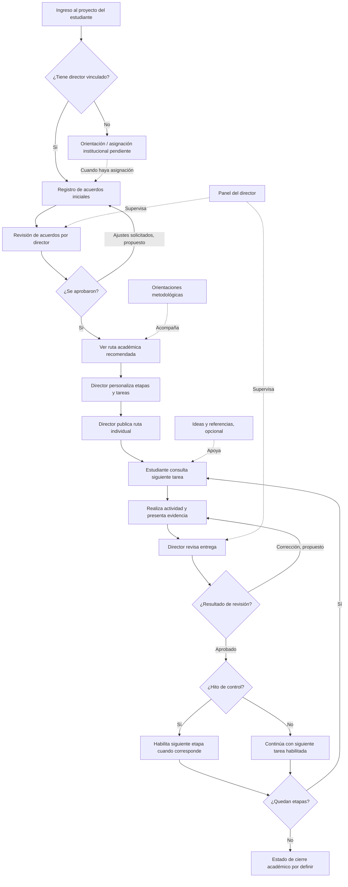
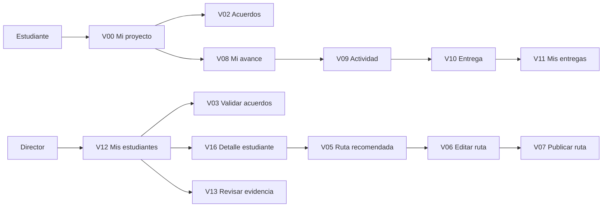

# Flujo funcional y visual integral de la plataforma de seguimiento académico

**Especificación de producto y experiencia — recorrido pantalla por pantalla**  
**Base documental:** reunión «La Reu Definitiva», 6 de noviembre de 2026, transcripción automática (aprox. 28 min).  
**Enfoque de este documento:** describir **cómo operará la plataforma**, no enumerar modificaciones respecto del sistema anterior.  
**Lectores:** gestión académica, dirección de proyecto, diseño UX/UI, desarrollo, QA y personas que validarán el prototipo.

> **Estado de definición.** La reunión sí sustenta este núcleo: **el estudiante registra acuerdos → el director los avala → se presenta una ruta recomendada → el director la personaliza → el estudiante ejecuta actividades y entrega evidencias → el director revisa y valida los hitos necesarios para continuar**. Los campos de formulario, los botones, los mensajes, las excepciones, la apariencia, las métricas, los permisos administrativos y las reglas finas son **propuestas funcionales** para convertir esa intención en un producto implementable; deben validarse antes del desarrollo. El audio presenta errores y frases incompletas: no se debe asumir que fijó textos, metodologías, autores o políticas de evaluación.

---

## 1. Qué experiencia se va a construir

La plataforma debe funcionar como un **acompañante del proceso académico con control del director**, no como un repositorio de archivos con botones de «completado».

**Para el estudiante**, la pregunta que debe resolver cada vista es: **«¿En qué etapa estoy, qué debo hacer ahora, qué debo entregar y qué está esperando aprobación?»**. 

**Para el director**, la pregunta es: **«¿Qué estudiantes tengo, quién necesita mi decisión, cuál es su ruta y qué evidencia debo revisar?»**.

**Principios que deben mantenerse durante todo el diseño:**

1. **La primera acción sustantiva es formalizar los acuerdos.** Antes de su aprobación no se desbloquea la ejecución académica de la ruta.
2. **La ruta es recomendada, no impuesta en bloque.** El director decide qué conserva, suprime, agrega y en qué orden, sujeto a mínimos institucionales todavía no definidos.
3. **La información de ruta y de tareas pertenece al proyecto individual.** Lo que cambia el director debe reflejarse, después de su publicación, en la experiencia del estudiante.
4. **«Entregar» no equivale a «aprobar».** El estudiante registra evidencia; el director emite su conformidad cuando corresponda.
5. **La aprobación debe tener consecuencias visibles.** Desbloquea la siguiente parte **solo en los hitos definidos como obligatorios**; nunca crear bloqueos arbitrarios.
6. **La pantalla de estudiante debe ser sencilla.** La del director debe soportar seguimiento de varios proyectos y dar prioridad a decisiones pendientes.
7. **Un indicador nunca se inventa.** Riesgo, auditoría, porcentajes y fechas aparecen únicamente cuando exista definición y datos confiables.

### 1.1 Convenciones de este documento

- **[REUNIÓN]**: intención o necesidad reconocible en la transcripción.
- **[PROPUESTA]**: diseño recomendado para ejecutar esa intención; no es acuerdo institucional.
- **[DECISIÓN]**: asunto que no debe darse por aprobado.
- **[MVP]**: pieza mínima para operar el circuito central.
- **[CONDICIONAL]**: módulo que solo se construye si gestión académica aprueba su alcance.
- `V00`, `V01`, ...: código de **visual/pantalla** (no código de historia de usuario).

### 1.2 Mapa del flujo completo



**Lectura importante:** «solicitar ajustes», «publicar ruta» y «cierre académico» son soluciones de producto propuestas para dar coherencia operativa. La reunión no precisó formalmente estos estados ni sus políticas.

### 1.3 Navegación general sugerida

| Perfil | Menú principal visible | Qué permite hacer | En el MVP |
|---|---|---|---|
| Estudiante | **Mi proyecto** | Ver estado inicial o avance, etapa activa y siguiente acción | Sí |
| Estudiante | **Mi ruta** | Consultar etapas, tareas y restricciones de avance | Sí |
| Estudiante | **Entregas** | Adjuntar y consultar evidencias y retroalimentación | Sí |
| Estudiante | **Ideas y referencias** | Guardar notas y materiales | Condicional |
| Director | **Mis estudiantes** | Identificar casos y entrar al detalle de cada proyecto | Sí, versión funcional mínima |
| Director | **Por revisar** | Acuerdos y evidencias pendientes de decisión | Sí |
| Director | **Ruta académica** | Consultar base, personalizar y confirmar itinerario por proyecto | Sí |
| Director | **Seguimiento** | Consultar historial, hitos y próximos compromisos | Sí, sin métricas no definidas |
| Coordinación académica | **Plantillas y lineamientos** | Gestionar rutas y referencias institucionales | Pendiente de permisos y alcance |

**Recomendación de navegación:** mostrar solo los menús que correspondan al perfil. No mezclar funciones de director en la pantalla del estudiante ni exponer ajustes de administración si no están autorizados.

### 1.4 Estados funcionales propuestos

| Objeto | Estados visibles recomendados | Qué significan | Restricción crucial |
|---|---|---|---|
| Acuerdos | Borrador → Pendiente de revisión → Aprobados; alterno: Ajustes solicitados | Avance de la formalización inicial | Sin «Aprobados» no se activa el trabajo de la ruta |
| Ruta individual | No configurada → Borrador → Publicada | Preparación del itinerario del proyecto | El estudiante ve solo la versión publicada |
| Tarea | Pendiente → En curso → Entregada → Aprobada; alterno: Correcciones solicitadas | Ciclo de ejecución y validación | «Entregada» no se trata como «Aprobada» |
| Etapa | Bloqueada / Disponible / En desarrollo / Validada | Progresión por el camino acordado | Solo cerrar/bloquear según hitos institucionales definidos |
| Evidencia | Cargada → En revisión → Aprobada; alterno: Solicita ajustes | Resultado presentado con historial | No sobrescribir ni perder la versión anterior sin una política definida |

**Nota:** estos nombres de estado son **[PROPUESTA]**. Debe aprobarse un catálogo único para impedir que diseño, frontend, backend y QA utilicen variantes incompatibles.

---

## 2. Recorrido visual narrado: qué verá cada persona

La secuencia se divide en cinco momentos: **inicio**, **formalización**, **construcción de la ruta**, **ejecución-validación** y **seguimiento**. Cada apartado define una pantalla o estado visual con su objetivo, una maqueta esquemática, los elementos que debe contener, los pasos de interacción, las validaciones y el resultado visible.

### Momento A. Entrada y primera conversación

La reunión supone que un estudiante puede estar vinculado a un director y plantea, como idea anterior a la selección, ofrecer orientación sobre el tutor idóneo. **La asignación institucional de director no fue descrita.** Por eso el ingreso debe contemplar la ausencia de vinculación sin inventar un proceso automático de selección.

#### V00 — Entrada al proyecto y estado inicial

**Quién la utiliza:** Estudiante  
**Navegación visible:** `Mi proyecto`  
**Naturaleza:** [PROPUESTA] · acceso operativo  
**Propósito:** Que el estudiante comprenda inmediatamente si ya puede iniciar el proceso o si aún falta la vinculación con un director.

**Wireframe funcional (distribución sugerida):**

```text
┌──────────────────────────────────────────────────────────────────────┐
│ LOGO / Plataforma académica                       Perfil · Salir   │
├───────────────┬──────────────────────────────────────────────────────┤
│ Mi proyecto   │ MI PROYECTO                                          │
│ Mi ruta       │ Proyecto: [nombre del proyecto]                      │
│ Entregas      │ Director: [nombre o «sin asignar»]                    │
│               │                                                      │
│               │ Estado: [Inicio pendiente / Acuerdos por registrar]   │
│               │ ┌──────────────────────────────────────────────────┐ │
│               │ │ SIGUIENTE ACCIÓN                                 │ │
│               │ │ [Registrar acuerdos iniciales]                   │ │
│               │ │ o «La asignación del director está pendiente»    │ │
│               │ └──────────────────────────────────────────────────┘ │
│               │ Pasos: Acuerdos — Ruta — Actividades — Validación     │
└───────────────┴──────────────────────────────────────────────────────┘
```

**Elementos del visual, de arriba abajo:**

- **A. Encabezado.** Nombre del proyecto y estudiante, sin indicadores que no tengan fuente.
- **B. Director asignado.** Mostrar nombre si hay vínculo válido; si no, «Pendiente de asignación».
- **C. Tarjeta de siguiente acción.** Un solo botón principal, coherente con el estado del proyecto.
- **D. Resumen de pasos.** Indicador sencillo del proceso, sin fingir progreso porcentual.

**Secuencia exacta de interacción:**

1. **Abrir «Mi proyecto»:** Cargar el proyecto propio y verificar vínculo con el director.
2. **Seleccionar «Registrar acuerdos»:** Abrir V02 solo si la relación estudiante–director ya está definida.
3. **Sin director vinculado:** Mostrar un mensaje informativo y una ruta de gestión institucional por definir; no atribuir director automáticamente.

**Reglas que no pueden perderse:**

- El estudiante solo puede acceder a su proyecto y sus datos asociados.
- No permitir entrar a etapas posteriores mediante URL mientras los acuerdos estén sin aprobar.
- El contenido de «Próximo compromiso» debe ser contextual: registrar acuerdos o esperar vinculación.

**Estado vacío / condición especial:** Si no existe proyecto activo, mostrar «No tienes un proyecto académico asociado» y un canal de soporte definido por la institución.

**Conexión con el siguiente visual:** V02 si ya tiene director; V01 únicamente si se aprueba el módulo opcional de orientación.


#### V01 — Orientación previa para escoger director (opcional)

**Quién la utiliza:** Estudiante / Gestión académica  
**Navegación visible:** `Orientación para tutor`  
**Naturaleza:** [CONDICIONAL] · idea de reunión 06:22  
**Propósito:** Ayudar a reflexionar qué perfil académico conviene al proyecto, sin sustituir el proceso formal de asignación.

**Wireframe funcional (distribución sugerida):**

```text
┌──────────────────────────────────────────────────────────────────────┐
│ ¿QUÉ PERFIL DE DIRECTOR NECESITA MI PROYECTO?                       │
│ Tema o línea de investigación [_______________________________]     │
│ Enfoque previsto            [Por definir ▼]                         │
│ Necesidad de acompañamiento [_______________________________]       │
│                                                                      │
│ Orientaciones institucionales                                       │
│ • Experiencia metodológica relacionada                              │
│ • Conocimiento del área                                             │
│ • Disponibilidad / asignación: por confirmar                         │
│                                                                      │
│ [Volver]                         [Consultar orientación]            │
│ Aviso: esta orientación NO asigna un director por sí sola.         │
└──────────────────────────────────────────────────────────────────────┘
```

**Elementos del visual, de arriba abajo:**

- **A. Contexto del proyecto.** Tema, enfoque si se conoce y necesidades de acompañamiento; campos exactos por aprobar.
- **B. Orientación.** Criterios para elegir perfil, no ranking automático sin datos válidos.
- **C. Aviso de autoridad.** Explicar que la asignación definitiva depende de las normas institucionales.

**Secuencia exacta de interacción:**

1. **Consultar orientación:** Mostrar lineamientos aprobados por coordinación académica.
2. **Continuar:** Devolver a V00 o al procedimiento formal institucional, aún pendiente.

**Reglas que no pueden perderse:**

- No mostrar porcentaje de compatibilidad ni «mejor tutor» sin metodología validada.
- No exponer datos personales o disponibilidad del personal docente sin permisos.

**Estado vacío / condición especial:** Si no hay lineamientos aprobados, ocultar el módulo o mostrar «Orientación no disponible».

**Conexión con el siguiente visual:** V00, una vez exista director asignado.


### Momento B. Formalización de la primera conversación

#### V02 — Registro formal de acuerdos iniciales

**Quién la utiliza:** Estudiante  
**Navegación visible:** `Mi proyecto → Acuerdos iniciales`  
**Naturaleza:** [REUNIÓN] · carga de acuerdos 06:55–07:14; diseño de campos [PROPUESTA]  
**Propósito:** Transformar la primera conversación en compromisos consultables y enviables al director.

**Wireframe funcional (distribución sugerida):**

```text
┌──────────────────────────────────────────────────────────────────────┐
│ ACUERDOS INICIALES                  Estado: [Borrador]              │
│ Proyecto: [nombre]  •  Director: [nombre]                            │
│                                                                      │
│ Información de la conversación (propuesta)                           │
│ Fecha de conversación  [____/____/____]                              │
│ Temas abordados        [____________________________________]        │
│ Acuerdos establecidos  [____________________________________]        │
│ Compromisos de trabajo [____________________________________]        │
│ Observaciones          [____________________________________]        │
│                                                                      │
│ Nota: «El director revisará estos acuerdos antes de continuar».      │
│ [Guardar borrador]                     [Enviar para aprobación]     │
└──────────────────────────────────────────────────────────────────────┘
```

**Elementos del visual, de arriba abajo:**

- **A. Cabecera.** Proyecto, director y estado del registro.
- **B. Formulario.** Campos propuestos para acuerdos de la conversación; el mínimo obligatorio se debe aprobar.
- **C. Advertencia.** Indicar expresamente que guardar no es enviar y enviar no es aprobar.
- **D. Acciones.** «Guardar borrador» y «Enviar para aprobación», con funciones claramente distintas.

**Secuencia exacta de interacción:**

1. **Escribir acuerdos:** Conservar el contenido en borrador, sin activar la ruta.
2. **Guardar borrador:** Persistir el contenido y confirmar «Borrador guardado».
3. **Enviar para aprobación:** Validar campos aprobados, cambiar a «Pendiente de revisión» y colocarlo en la cola del director (V03).
4. **Volver a abrir:** Mostrar el estado real y la versión enviada; bloquear edición libre del envío o permitir nueva versión según decisión.

**Reglas que no pueden perderse:**

- La formalización inicial es requisito previo al inicio de la ruta [REUNIÓN].
- Los campos «fecha», «temas» y «observaciones» son sugeridos, no fijados por el audio.
- No habilitar «Comenzar ruta» por el solo hecho de guardar o enviar.
- Registrar autor de la versión y fecha/hora del envío (recomendación de trazabilidad).

**Estado vacío / condición especial:** Primer ingreso: campos vacíos con ejemplo genérico y explicación corta; si hay borrador, precargarlo.

**Conexión con el siguiente visual:** V03 (director) y V04 (espera del estudiante).


#### V03 — Revisión y validación de acuerdos

**Quién la utiliza:** Director  
**Navegación visible:** `Por revisar → Acuerdos`  
**Naturaleza:** [REUNIÓN] · director da conformidad 07:14 y 09:53  
**Propósito:** Permitir al director comprobar si el estudiante registró fielmente lo acordado y emitir su aval.

**Wireframe funcional (distribución sugerida):**

```text
┌──────────────────────────────────────────────────────────────────────┐
│ REVISAR ACUERDOS                                                     │
│ Estudiante: [nombre]   Proyecto: [nombre]                             │
│ Estado: [Pendiente de revisión]     Enviado: [fecha]                │
│                                                                      │
│ Resumen de los acuerdos                                             │
│ [Contenido enviado, de solo lectura]                                │
│                                                                      │
│ Comentarios al estudiante [____________________________]             │
│                                                                      │
│ [Solicitar ajustes]                         [Aprobar acuerdos]      │
│ Aviso: «Aprobar habilitará configurar la ruta académica».           │
└──────────────────────────────────────────────────────────────────────┘
```

**Elementos del visual, de arriba abajo:**

- **A. Identificación.** Quién entrega y qué proyecto se revisa; evita aprobar el proyecto equivocado.
- **B. Contenido consolidado.** Información textual de la versión enviada, sin confundirla con una plantilla vacía.
- **C. Comentarios.** Caja para retroalimentación, especialmente si se solicita ajuste; propuesta.
- **D. Decisión.** Dos acciones diferenciadas. «Aprobar» requiere una confirmación visible; «Solicitar ajustes» es propuesta de excepción.

**Secuencia exacta de interacción:**

1. **Abrir una solicitud:** Marcarla como consultada sin alterar su aprobación.
2. **Aprobar acuerdos:** Registrar conformidad del director; habilitar V05 y acceso posterior al editor V06.
3. **Solicitar ajustes [PROPUESTA]:** Exigir observación de motivo si se adopta esta opción; devolver a V02 con nueva versión pendiente.
4. **Consultar registro aprobado:** Permitir lectura posterior de contenido y aval, sin borrarlo.

**Reglas que no pueden perderse:**

- Solo el director vinculado (o rol autorizado por la institución) puede aprobar.
- No permitir doble aprobación contradictoria sobre la misma versión.
- El significado de «conciliación» debe aclararse: podría implicar otra aceptación adicional; no inventarla.

**Estado vacío / condición especial:** Sin acuerdos pendientes: «No tienes acuerdos por revisar», con acceso a «Mis estudiantes».

**Conexión con el siguiente visual:** V05 si aprueba; V04 si el estudiante queda esperando o debe corregir.


#### V04 — Estado de acuerdos: espera, ajuste o aprobación

**Quién la utiliza:** Estudiante  
**Navegación visible:** `Mi proyecto → Estado inicial`  
**Naturaleza:** [PROPUESTA] · estados para materializar la condición de avance  
**Propósito:** Evitar que el estudiante confunda un registro enviado con la aprobación académica.

**Wireframe funcional (distribución sugerida):**

```text
┌──────────────────────────────────────────────────────────────────────┐
│ ESTADO DE LOS ACUERDOS                                               │
│                                                                      │
│ [PENDIENTE DE REVISIÓN]                                              │
│ Los acuerdos ya fueron enviados a tu director.                      │
│ La ruta se habilitará cuando exista el aval correspondiente.         │
│                                                                      │
│ ── Variante si hay devolución ──                                     │
│ [AJUSTES SOLICITADOS]                                                │
│ Observación del director: [texto]                                    │
│ [Corregir acuerdos]                                                  │
│                                                                      │
│ ── Variante aprobada ──                                              │
│ [ACUERDOS APROBADOS]                                                 │
│ Tu director configurará el recorrido de trabajo.                    │
└──────────────────────────────────────────────────────────────────────┘
```

**Elementos del visual, de arriba abajo:**

- **A. Estado prominente.** Solo uno entre pendiente, ajustes o aprobado.
- **B. Próxima acción contextual.** Esperar, corregir o consultar que se está preparando la ruta.
- **C. Comentarios.** Mostrar explicación del director cuando aplique.

**Secuencia exacta de interacción:**

1. **Corregir acuerdos:** Volver a V02 conservando contenido previo y comentarios.
2. **Consultar el registro:** Abrir versión enviada y su trazabilidad.
3. **Volver a inicio:** Mostrar la situación en V00 y no una etapa que aún no existe.

**Reglas que no pueden perderse:**

- No mostrar tareas académicas activas cuando no hay ruta publicada.
- El estado «Aprobados» no significa que ya exista ruta lista para ejecutar.

**Estado vacío / condición especial:** Si nunca se enviaron acuerdos, el botón debe decir «Registrar acuerdos», no «Esperar revisión».

**Conexión con el siguiente visual:** V05 para el director; V08 para el estudiante solo cuando la ruta se publique.


### Momento C. Selección, ajuste y publicación de la ruta

#### V05 — Consulta de ruta recomendada y orientaciones académicas

**Quién la utiliza:** Director  
**Navegación visible:** `Ruta académica → Seleccionar base`  
**Naturaleza:** [REUNIÓN] · 07:39 y 14:48; contenido académico [DECISIÓN]  
**Propósito:** Ofrecer un punto de partida comprensible antes de editar cada ruta individual, con recomendaciones y fuentes verificables.

**Wireframe funcional (distribución sugerida):**

```text
┌──────────────────────────────────────────────────────────────────────┐
│ CONFIGURAR RUTA ACADÉMICA                                            │
│ Proyecto: [nombre]  • Acuerdos: [Aprobados ✓]                         │
│                                                                      │
│ Enfoque de investigación [Seleccione una opción aprobada ▼]          │
│                                                                      │
│ RUTA RECOMENDADA                         GUÍA ACADÉMICA              │
│ 1. [Etapa académica 1]                    Fundamento [referencia]      │
│    • [Actividad orientadora]              ¿Por qué se sugiere?        │
│ 2. [Etapa académica 2]                    [Resumen de orientación]    │
│    • [Actividad orientadora]              [Consultar fuente]          │
│ 3. [Etapa académica 3]                                                │
│                                                                      │
│ [Volver]                           [Personalizar esta ruta]         │
└──────────────────────────────────────────────────────────────────────┘
```

**Elementos del visual, de arriba abajo:**

- **A. Proyecto y condición de acceso.** Mostrar acuerdos aprobados antes de permitir configuración.
- **B. Selector de enfoque.** Solo enfoques y rutas validados por coordinación; no suponer listas fijas.
- **C. Ruta base.** Etapas con actividades sugeridas y orden inicial.
- **D. Recomendaciones.** Contexto metodológico y referencia verificable, antes de editar.
- **E. Acción principal.** Personalizar una copia para este proyecto; no modificar la plantilla maestra.

**Secuencia exacta de interacción:**

1. **Elegir enfoque:** Cargar contenido institucional correspondiente, si existe.
2. **Leer orientación:** Mostrar fuente, recomendación, limitaciones y por qué aplica.
3. **Personalizar esta ruta:** Crear borrador individual basado en la plantilla seleccionada; abrir V06.
4. **No existe ruta para enfoque:** Ofrecer salida institucional definida: crear desde estructura vacía solo si se autoriza.

**Reglas que no pueden perderse:**

- La fuente menciona una ruta recomendada para investigación cualitativa y técnicas como entrevista, pero NO entrega catálogo oficial.
- No atribuir automáticamente el autor transcrito como «San Pier»: es dudoso.
- La ruta de base debe seguir existiendo aunque la del estudiante cambie.

**Estado vacío / condición especial:** Mostrar «No hay una ruta aprobada para este enfoque» y bloquear «Personalizar» hasta resolver la alternativa académica.

**Conexión con el siguiente visual:** V06, editor de la ruta individual.


#### V06 — Editor de ruta personalizada del director

**Quién la utiliza:** Director  
**Navegación visible:** `Ruta académica → Editar ruta del proyecto`  
**Naturaleza:** [REUNIÓN] · conservar/quitar/agregar/reordenar 10:15  
**Propósito:** Que el director construya exactamente el camino que recibirá el estudiante.

**Wireframe funcional (distribución sugerida):**

```text
┌──────────────────────────────────────────────────────────────────────┐
│ EDITAR RUTA DE [PROYECTO]                   [Vista previa]           │
│ Ruta de base: [plantilla y versión]          Estado [Borrador]       │
│                                                                      │
│ ETAPAS Y ACTIVIDADES                      ORIENTACIÓN / DETALLE       │
│ [≡] Etapa 1: [título]             [↑ ↓]    Objetivo [texto]          │
│     [☑] Actividad A               [✎] [×]  Evidencia sugerida [..]  │
│     [☑] Actividad B               [✎] [×]  Criterio de aval [..]     │
│     [+ Añadir actividad]                    Fuente académica [..]    │
│ [≡] Etapa 2: [título]             [↑ ↓]                             │
│     [☑] Actividad C               [✎] [×]                            │
│ [+ Añadir etapa]                                                   │
│                                                                      │
│ [Deshacer cambios] [Guardar borrador] [Previsualizar y publicar]    │
└──────────────────────────────────────────────────────────────────────┘
```

**Elementos del visual, de arriba abajo:**

- **A. Barra superior.** Proyecto, origen de la ruta y estado del borrador.
- **B. Constructor de etapas.** Lista ordenable; cada etapa agrupa tareas con un objetivo.
- **C. Acciones por elemento.** Conservar, retirar, editar, agregar y cambiar el orden.
- **D. Panel de orientación.** Mostrar descripción y referencias, sin ocupar todo el espacio.
- **E. Acciones finales.** Guardar borrador, previsualizar, publicar solo tras revisión.

**Secuencia exacta de interacción:**

1. **Conservar elemento:** Dejarlo dentro del recorrido individual.
2. **Quitar elemento:** Retirarlo del borrador del proyecto, sin eliminarlo del catálogo de base.
3. **Agregar elemento:** Definir título y propósito; campos de evidencia y aprobación sujetos a política.
4. **Reordenar:** Actualizar secuencia que verá el estudiante; facilitar teclado además de arrastrar.
5. **Guardar borrador:** Persistir modificaciones sin mostrar aún la nueva versión al estudiante.
6. **Previsualizar:** Abrir V07 con el contenido exacto que va a recibir el estudiante.

**Reglas que no pueden perderse:**

- No mezclar edición de ruta maestra con la edición individual.
- La reunión no define qué etapas son ineludibles. Hasta aprobar esto, no inventar restricciones por metodología.
- Si se modifica una ruta YA publicada, exigir una regla aprobada de versionamiento y tratamiento de tareas con evidencia.
- Si el director sale sin guardar, avisar sobre cambios no persistidos.

**Estado vacío / condición especial:** Si se retiraron todas las etapas, mostrar advertencia de ruta vacía; publicar solo conforme a mínimos institucionales definidos.

**Conexión con el siguiente visual:** V07 para revisión y publicación de la ruta.


#### V07 — Vista previa y publicación de la ruta

**Quién la utiliza:** Director  
**Navegación visible:** `Ruta académica → Vista previa`  
**Naturaleza:** [PROPUESTA] · control de calidad antes de asignar  
**Propósito:** Permitir al director detectar errores de orden o contenido antes de convertir la ruta en tareas del estudiante.

**Wireframe funcional (distribución sugerida):**

```text
┌──────────────────────────────────────────────────────────────────────┐
│ ANTES DE ASIGNAR LA RUTA                                            │
│ Proyecto: [nombre]     Versión: [número provisional]                │
│                                                                      │
│ ASÍ LA VERÁ EL ESTUDIANTE                                           │
│ [1] [Etapa 1]  ── [Tarea A] ── [Tarea B]                             │
│ [2] [Etapa 2]  ── [Tarea C]                                           │
│ [3] [Etapa 3]  ── [Tarea D]                                           │
│                                                                      │
│ Resumen: [n.º etapas] / [n.º actividades] (valores reales)           │
│ Aviso: la publicación habilitará el seguimiento académico.          │
│                                                                      │
│ [Volver a editar]                         [Confirmar publicación]   │
└──────────────────────────────────────────────────────────────────────┘
```

**Elementos del visual, de arriba abajo:**

- **A. Proyecto y versión.** Identificar el borrador que se está por publicar.
- **B. Vista previa del estudiante.** Mostrar tareas y orden, sin acciones de ejecución.
- **C. Resumen real.** Contadores calculados únicamente desde el borrador.
- **D. Confirmación.** Explicación del efecto de publicar: asignación al proyecto.

**Secuencia exacta de interacción:**

1. **Volver a editar:** Retornar V06 sin perder cambios.
2. **Confirmar publicación:** Crear versión publicada y tareas correspondientes; abrir V08 para estudiante.
3. **Falla de publicación:** Mantener borrador, notificar error y permitir reintentar sin duplicar tareas.

**Reglas que no pueden perderse:**

- Solo una versión activa de ruta por proyecto, a menos que se acuerde otra política.
- No generar tareas repetidas si el director pulsa publicar dos veces.
- La publicación necesita acuerdos iniciales validados.

**Estado vacío / condición especial:** Si no hay tareas configuradas, impedir publicación o tratar según política institucional.

**Conexión con el siguiente visual:** V08 (estudiante) y V12/V16 (director).


### Momento D. Ejecución, evidencias y validación

#### V08 — Inicio del estudiante con la ruta activa

**Quién la utiliza:** Estudiante  
**Navegación visible:** `Mi proyecto`  
**Naturaleza:** [REUNIÓN] · tareas derivadas de ruta 10:15 y seguimiento 19:29  
**Propósito:** Responder en una mirada: dónde está, qué debe hacer y qué espera del director.

**Wireframe funcional (distribución sugerida):**

```text
┌──────────────────────────────────────────────────────────────────────┐
│ MI PROYECTO                                     [Ver ruta completa] │
│ Proyecto: [nombre]   Director: [nombre]   Estado: [En ejecución]    │
│                                                                      │
│ ▸ ETAPA ACTUAL: [título]                                             │
│   [Indicador por tareas/hitos aprobados, si se define fórmula]       │
│                                                                      │
│ ┌──────────────────────────────────────────┐ ┌─────────────────────┐│
│ │ QUÉ DEBO HACER AHORA                     │ │ MIS ENTREGAS        ││
│ │ [Tarea prioritaria disponible]           │ │ [en revisión: n]    ││
│ │ [Abrir actividad]                        │ │ [con ajustes: n]    ││
│ └──────────────────────────────────────────┘ └─────────────────────┘│
│                                                                      │
│ MI RUTA:  [✓ Etapa 1] → [● Etapa 2] → [○ Etapa 3]                    │
└──────────────────────────────────────────────────────────────────────┘
```

**Elementos del visual, de arriba abajo:**

- **A. Contexto mínimo.** Título, director y estado académico.
- **B. Etapa actual.** Nombrar etapa activa y no una fecha arbitraria.
- **C. Próxima acción principal.** Una tarjeta con botón para entrar a la tarea que corresponda.
- **D. Estado de entregas.** Número real de entregas por revisar y devoluciones, si hay.
- **E. Ruta resumida.** Etapas aprobadas, etapa actual y etapas no disponibles.

**Secuencia exacta de interacción:**

1. **Abrir actividad:** Ir a V09, con el detalle de tarea.
2. **Ver ruta completa:** Abrir mapa de etapas (V09, sección de navegación).
3. **Consultar entrega en revisión:** Ir a V11 en modo lectura o a V14 si hay correcciones.

**Reglas que no pueden perderse:**

- Mantener una vista simple y no replicar un panel ejecutivo complejo al estudiante.
- La tarea destacada debe derivarse de la ruta publicada y de reglas de desbloqueo, no de suposiciones de prioridad.
- No llamar «completado» a un resultado que espera aval.

**Estado vacío / condición especial:** Ruta publicada, pero sin tarea disponible: explicar qué validación está pendiente y quién debe actuar.

**Conexión con el siguiente visual:** V09 detalle de etapa y tarea.


#### V09 — Mapa de etapas y detalle de la actividad

**Quién la utiliza:** Estudiante  
**Navegación visible:** `Mi ruta → Etapa → Actividad`  
**Naturaleza:** [REUNIÓN] · actividades de ruta con seguimiento y check 10:15  
**Propósito:** Indicar el objetivo exacto de cada actividad y qué cuenta como avance verificable.

**Wireframe funcional (distribución sugerida):**

```text
┌──────────────────────────────────────────────────────────────────────┐
│ MI RUTA  /  [ETAPA ACTUAL]                                           │
│                                                                      │
│ ETAPAS                            ACTIVIDAD SELECCIONADA             │
│ ✓ [Etapa aprobada]                Título [actividad]                 │
│ ● [Etapa disponible]              ¿Qué hay que hacer? [instrucción]  │
│ 🔒 [Etapa pendiente]              Orientaciones [referencia]        │
│                                   Resultado esperado [descripción]   │
│ ACTIVIDADES:                      Estado [Pendiente / En curso]       │
│ [ ] [Tarea A]                                                         │
│ [ ] [Tarea B]                     [Empezar]   [Entregar evidencia]   │
│ [✓] [Tarea revisada]                                                 │
└──────────────────────────────────────────────────────────────────────┘
```

**Elementos del visual, de arriba abajo:**

- **A. Mapa de etapas.** Mostrar secuencia aprobada, qué está habilitado y qué espera aval.
- **B. Lista de actividades.** Cada tarea con nombre y estado; si hay check, su significado debe ser preciso.
- **C. Ficha de actividad.** Objetivo, instrucciones y entregable esperado en lenguaje académico claro.
- **D. Orientaciones.** Referencias del método aprobadas y opcionales, sin alterar el requisito del director.
- **E. Llamado a la acción.** Cambiar según estado: «Empezar», «Entregar», «Ver revisión» o «Corregir».

**Secuencia exacta de interacción:**

1. **Marcar como iniciada:** Si se adopta ese estado, registrar inicio sin afirmar que la tarea fue aprobada.
2. **Entregar evidencia:** Abrir V10 vinculando proyecto, etapa y tarea.
3. **Abrir etapa bloqueada:** No permitir ejecución; explicar cuál hito debe recibir aval.
4. **Volver al mapa:** Mantener contexto de la actividad y etapa previamente elegidas.

**Reglas que no pueden perderse:**

- «Chulear tarea» aparece en la reunión, pero debe aclararse si significa avance personal o tarea formalmente avalada.
- Una misma evidencia no debe quedar asociada por accidente a otra actividad.
- No obligar a cargar un archivo si esa tarea fue aprobada como tarea sin evidencia.

**Estado vacío / condición especial:** Si la actividad carece de instrucciones, mostrar el objetivo o un aviso institucional; no inventar instrucciones metodológicas.

**Conexión con el siguiente visual:** V10 para presentar evidencia.


#### V10 — Entrega de evidencia por actividad

**Quién la utiliza:** Estudiante  
**Navegación visible:** `Mi ruta → Actividad → Entregar evidencia`  
**Naturaleza:** [REUNIÓN] · cargar evidencia 15:18–15:49  
**Propósito:** Recibir la entrega de forma inequívoca y colocarla a revisión del director.

**Wireframe funcional (distribución sugerida):**

```text
┌──────────────────────────────────────────────────────────────────────┐
│ ENTREGAR EVIDENCIA                                                   │
│ Proyecto [nombre] / Etapa [nombre] / Tarea [nombre]                   │
│                                                                      │
│ Resultado esperado: [descripción definida por la ruta]               │
│                                                                      │
│ ┌──────────────────────────────────────────────────────────────────┐ │
│ │ Arrastra un archivo o selecciona un archivo                     │ │
│ │ Tipos y peso permitido: [según política aprobada]                │ │
│ └──────────────────────────────────────────────────────────────────┘ │
│ Comentario para el director [____________________________]           │
│ Archivo seleccionado: [nombre / tamaño]                              │
│                                                                      │
│ [Cancelar]                           [Enviar evidencia a revisión]  │
└──────────────────────────────────────────────────────────────────────┘
```

**Elementos del visual, de arriba abajo:**

- **A. Identificación del entregable.** Ruta proyecto → etapa → tarea, fija y siempre visible.
- **B. Qué debe presentarse.** Descripción de resultado esperado, si el director la definió.
- **C. Carga.** Selector accesible, progreso de carga y validación de formatos aprobados.
- **D. Comentario.** Aclaración del estudiante, si se decide permitirla.
- **E. Enviar.** Acción que deja la entrega en «En revisión», nunca en «Aprobada».

**Secuencia exacta de interacción:**

1. **Seleccionar archivo:** Validar extensión, tamaño y que se adjunte al objeto correcto.
2. **Enviar evidencia:** Guardar evidencia, asociarla con su versión, registrar autor y colocar ítem en la cola del director.
3. **Cancelar:** Salir sin generar envío; si hay carga temporal, tratarla según política.
4. **Consultar envío:** Abrir V11, donde aparece el estado real y fecha del registro.

**Reglas que no pueden perderse:**

- Formatos y límites NO están definidos en la reunión; deben configurarse después de aprobación.
- Implementar manejo claro de fallas de red: no mostrar «entregado» si el archivo no se guardó.
- Prevenir duplicados por doble clic; almacenar resultado de cada envío.
- La recepción no desbloquea por sí sola el siguiente hito.

**Estado vacío / condición especial:** Sin archivo seleccionado, botón deshabilitado solo si el entregable exige archivo; otras formas de evidencia requieren definición.

**Conexión con el siguiente visual:** V11 estado de entrega y V13 cola de revisión del director.


#### V11 — Estado y seguimiento de evidencias enviadas

**Quién la utiliza:** Estudiante  
**Navegación visible:** `Mis entregas → Detalle`  
**Naturaleza:** [PROPUESTA] · transparencia de revisión  
**Propósito:** Diferenciar claramente una evidencia enviada, en revisión, corregida y aprobada.

**Wireframe funcional (distribución sugerida):**

```text
┌──────────────────────────────────────────────────────────────────────┐
│ MIS ENTREGAS                                                         │
│ Actividad: [nombre de tarea]                                         │
│                                                                      │
│ [Versión 1] [Archivo] [En revisión] [fecha de envío]                │
│ [Versión 2] [Archivo] [Aprobada]   [fecha de aval, si existe]       │
│                                                                      │
│ ESTADO DE LA REVISIÓN                                                │
│ [En revisión]                                                        │
│ El director aún no ha registrado su decisión.                        │
│                                                                      │
│ [Volver a mi ruta]                             [Ver historial]      │
└──────────────────────────────────────────────────────────────────────┘
```

**Elementos del visual, de arriba abajo:**

- **A. Actividad vinculada.** Contextualizar evidencia respecto del proyecto.
- **B. Archivo o material.** Mostrar nombre, fecha y versión si se aceptó versionamiento.
- **C. Estado visible.** Usar palabras distintas para enviado, revisado y aprobado.
- **D. Historial.** Conservar comentario de revisión y movimientos si la política los permite.

**Secuencia exacta de interacción:**

1. **Ver evidencia:** Abrir/descargar según permisos; no perder contexto.
2. **Ver historial:** Mostrar eventos ordenados: envío, revisión, ajuste y aval.
3. **Corregir:** Si hay ajustes solicitados, abrir V14.

**Reglas que no pueden perderse:**

- No presentar una entrega pendiente como actividad completada y aprobada.
- No falsificar fechas de revisión o comentario del director.
- Las versiones anteriores deben conservar trazabilidad conforme a política de datos.

**Estado vacío / condición especial:** Ninguna evidencia: mostrar instrucciones de primer envío y enlace a V09.

**Conexión con el siguiente visual:** V13 revisión por director; V14 corrección cuando corresponda.


### Momento E. Acompañamiento y supervisión por el director

#### V12 — Panel principal del director: mis estudiantes

**Quién la utiliza:** Director  
**Navegación visible:** `Mis estudiantes`  
**Naturaleza:** [REUNIÓN] · panel a mejorar 24:16–25:58  
**Propósito:** Ayudar al director a identificar de inmediato quién tiene acuerdos pendientes, quién necesita revisión y dónde está cada estudiante.

**Wireframe funcional (distribución sugerida):**

```text
┌──────────────────────────────────────────────────────────────────────┐
│ MIS ESTUDIANTES                            [Buscar] [Filtro ▼]      │
│                                                                      │
│ ┌──────────────────────────────────────────────────────────────────┐ │
│ │ ACUERDOS POR REVISAR [n] | EVIDENCIAS POR REVISAR [n]          │ │
│ └──────────────────────────────────────────────────────────────────┘ │
│                                                                      │
│ Estudiante  Proyecto  Etapa actual  Revisión pendiente    Acción     │
│ [nombre]    [texto]   [etapa]       [acuerdos]           [Revisar]   │
│ [nombre]    [texto]   [etapa]       [evidencia]          [Revisar]   │
│ [nombre]    [texto]   [etapa]       [ninguna]            [Ver]       │
│                                                                      │
│ [Ver todos]         [Ver pendientes de revisión]                     │
└──────────────────────────────────────────────────────────────────────┘
```

**Elementos del visual, de arriba abajo:**

- **A. Encabezado operativo.** «Mis estudiantes», no dashboard saturado de KPIs.
- **B. Dos contadores accionables.** Acuerdos y evidencias pendientes, obtenidos de datos reales.
- **C. Tabla de estudiantes.** Nombre, proyecto, etapa actual, acción requerida y acceso al detalle.
- **D. Filtros.** Por estado de revisión o búsqueda; filtros más complejos solo si aportan valor.
- **E. Acción por fila.** «Revisar» si hay pendiente, «Ver» si solo quiere consultar.

**Secuencia exacta de interacción:**

1. **Entrar en «Acuerdos por revisar»:** Abrir la cola filtrada y luego V03.
2. **Entrar en «Evidencias por revisar»:** Abrir la cola y luego V13.
3. **Abrir un estudiante:** Mostrar V16 sin perder el filtro aplicado.
4. **Filtrar:** Filtrar únicamente por atributos reales del proyecto.

**Reglas que no pueden perderse:**

- La lista se restringe a los estudiantes a cargo del director o permisos institucionales autorizados.
- No mostrar «riesgo medio» ni «auditoría» sin criterios académicos y fórmulas formalizados.
- No agregar métricas decorativas; cada tarjeta debe conducir a una acción concreta.

**Estado vacío / condición especial:** Sin estudiantes asignados: explicar que no hay proyectos a cargo; sin pendientes: mensaje de revisión al día.

**Conexión con el siguiente visual:** V03 (acuerdos), V13 (evidencias), V16 (detalle de estudiante).


#### V13 — Bandeja de evidencias y revisión de entregable

**Quién la utiliza:** Director  
**Navegación visible:** `Por revisar → Evidencia de actividad`  
**Naturaleza:** [REUNIÓN] · revisión y aval 15:49–16:48  
**Propósito:** Que el director tenga información suficiente para revisar una entrega y decidir si avala el trabajo.

**Wireframe funcional (distribución sugerida):**

```text
┌──────────────────────────────────────────────────────────────────────┐
│ REVISIÓN DE EVIDENCIA                                                │
│ Estudiante [nombre]  → Etapa [nombre] → Actividad [nombre]            │
│                                                                      │
│ Evidencia presentada                                                 │
│ [Documento / vínculo disponible]  [Abrir]                            │
│ Comentario del estudiante: [texto, si existe]                        │
│                                                                      │
│ Criterio/resultado esperado: [definido en la ruta]                   │
│ Observaciones del director: [____________________________]           │
│                                                                      │
│ [Solicitar correcciones]                   [Aprobar evidencia]       │
│ Al aprobar: se evaluará si corresponde habilitar otro hito.         │
└──────────────────────────────────────────────────────────────────────┘
```

**Elementos del visual, de arriba abajo:**

- **A. Identificación contextual.** Quién entregó, en qué tarea y para cuál ruta.
- **B. Evidencia.** Abrir archivo sin perder referencia del estudiante.
- **C. Resultado esperado.** Mostrar la definición de tarea publicada, no un criterio inventado.
- **D. Observaciones.** Respuesta del director vinculada al intento de entrega.
- **E. Decisión.** Aprobar o solicitar correcciones; el segundo comportamiento es propuesta que requiere validación.

**Secuencia exacta de interacción:**

1. **Abrir entrega:** Revisar contenido, metadatos y versión.
2. **Aprobar evidencia:** Registrar aval y actualizar estados; evaluar desbloqueo de etapa según matriz de hitos.
3. **Solicitar correcciones [PROPUESTA]:** Registrar motivo y devolver la tarea a estado de ajustes; mostrar resultado en V14.
4. **Volver a lista:** Retornar al panel con contador actualizado si cambió estado.

**Reglas que no pueden perderse:**

- La validación debe quedar asociada al director, entrega y fecha.
- No dar aval a una evidencia que no pertenece al estudiante asignado.
- No cerrar automáticamente otras tareas por aprobar una evidencia.
- Si la acción falla, conservar estado anterior y evitar mensaje de «aprobado».

**Estado vacío / condición especial:** Si aún no existe evidencia, no habilitar acciones de aval.

**Conexión con el siguiente visual:** V14 (ajustes, condicional) o V15 (avance tras aval).


#### V14 — Correcciones y nueva presentación

**Quién la utiliza:** Estudiante  
**Navegación visible:** `Mis entregas → Ajustes solicitados`  
**Naturaleza:** [PROPUESTA] · resolución de devoluciones aún no definida  
**Propósito:** Permitir recuperar el trabajo con una devolución clara y una nueva entrega verificable, si la institución aprueba esta modalidad.

**Wireframe funcional (distribución sugerida):**

```text
┌──────────────────────────────────────────────────────────────────────┐
│ AJUSTES SOLICITADOS                                                  │
│ Actividad: [nombre]                                                  │
│ Observación de tu director: [comentario]                             │
│                                                                      │
│ Entrega anterior: [archivo] [fecha]                                  │
│                                                                      │
│ NUEVA VERSIÓN                                                        │
│ [Adjuntar archivo corregido]                                         │
│ Comentario [________________________]                                │
│                                                                      │
│ [Volver]                                   [Enviar nueva versión]    │
└──────────────────────────────────────────────────────────────────────┘
```

**Elementos del visual, de arriba abajo:**

- **A. Motivo de ajuste.** Mensaje visible con comentario, sin ambigüedad.
- **B. Entrega anterior.** Disponible de lectura para recuperar contexto.
- **C. Nueva versión.** Formulario de nueva presentación vinculado a la misma tarea.

**Secuencia exacta de interacción:**

1. **Consultar observación:** Leer lo solicitado por el director.
2. **Enviar nueva versión:** Conservar historial y colocar nueva entrega en V13.
3. **Salir sin enviar:** Mantener estado de ajustes y conservar, o descartar, borrador según política.

**Reglas que no pueden perderse:**

- No borrar automáticamente la entrega anterior.
- No marcar aval hasta nueva decisión del director.
- Definir si hay límites de correcciones y qué ocurre con fechas de compromiso.

**Estado vacío / condición especial:** Si no hay observación, mostrar «El director solicitó revisión» solo si se formalizó esa posibilidad; pedir definición institucional.

**Conexión con el siguiente visual:** V11 tras envío y V13 para nueva revisión.


#### V15 — Hito validado y avance a siguiente etapa

**Quién la utiliza:** Estudiante / Plataforma  
**Navegación visible:** `Mi ruta → Estado de avance`  
**Naturaleza:** [REUNIÓN] · aval en puntos clave 16:48  
**Propósito:** Hacer visible que el aval del director tiene un efecto académico concreto, sin saltarse pasos.

**Wireframe funcional (distribución sugerida):**

```text
┌──────────────────────────────────────────────────────────────────────┐
│ RESULTADO DE LA VALIDACIÓN                                           │
│                                                                      │
│ [✓ Evidencia aprobada por el director]                               │
│ Actividad: [nombre]                                                  │
│                                                                      │
│ SI ES HITO DE CONTROL                                               │
│ [✓ Etapa anterior validada]  →  [● Siguiente etapa disponible]        │
│                                                                      │
│ SI NO ES HITO DE CONTROL                                            │
│ [✓ Actividad validada]       →  [● Siguiente tarea disponible]        │
│                                                                      │
│ [Consultar detalle]                     [Ir al siguiente paso]      │
└──────────────────────────────────────────────────────────────────────┘
```

**Elementos del visual, de arriba abajo:**

- **A. Confirmación.** Qué se aprobó exactamente y quién dio el aval.
- **B. Efecto.** Qué tarea o etapa puede continuar en consecuencia.
- **C. Navegación.** Botón a la siguiente acción real, no a una etapa todavía bloqueada.

**Secuencia exacta de interacción:**

1. **Procesar aprobación:** Consultar si ese punto exige aval y si existen otros requisitos pendientes.
2. **Habilitar avance:** Activar solo la transición aprobada; no inferir paso completo por un check.
3. **Ir al siguiente paso:** Volver a V08/V09 mostrando la tarea disponible.

**Reglas que no pueden perderse:**

- La reunión pide aprobación sobre todo en etapas críticas, pero no enumera esas etapas.
- La matriz de hitos que bloquean/desbloquean es una decisión académica previa al desarrollo.
- No mostrar avance porcentual si no se ha aprobado fórmula de cálculo.

**Estado vacío / condición especial:** Cuando no hay siguiente tarea, mostrar «Ruta ejecutada; estado académico de cierre pendiente de definición», no «título aprobado» o «graduado».

**Conexión con el siguiente visual:** V08/V09 para continuar o V18 para cierre administrativo por definir.


#### V16 — Detalle del estudiante para el director

**Quién la utiliza:** Director  
**Navegación visible:** `Mis estudiantes → Perfil del proyecto`  
**Naturaleza:** [REUNIÓN] · ver dónde van y qué han entregado 24:16  
**Propósito:** Centralizar en una sola vista las decisiones que el director debe tomar sobre un estudiante concreto.

**Wireframe funcional (distribución sugerida):**

```text
┌──────────────────────────────────────────────────────────────────────┐
│ [← Mis estudiantes]    PROYECTO DE [ESTUDIANTE]                      │
│ Director: [nombre]     Acuerdos: [aprobados/pte.]                    │
│                                                                      │
│ ┌──────────────────────┐ ┌─────────────────────────────────────────┐│
│ │ RUTA PERSONALIZADA   │ │ ACCIONES PENDIENTES                     ││
│ │ Etapa 1  [✓]         │ │ [Revisar acuerdos] / [Revisar evidencia] ││
│ │ Etapa 2  [●]         │ │ [Configurar ruta] / [Ver actividad]      ││
│ │ Etapa 3  [○]         │ └─────────────────────────────────────────┘│
│ └──────────────────────┘                                          │
│ Entregas recientes   |   Historial de validaciones   |  Comentarios │
│ [lista real ordenada por fecha]                                    │
└──────────────────────────────────────────────────────────────────────┘
```

**Elementos del visual, de arriba abajo:**

- **A. Cabecera individual.** Estudiante, proyecto y director.
- **B. Ruta actual.** Secuencia real publicada y estado por etapa.
- **C. Pendientes que requieren decisión.** Acciones que efectivamente puede ejecutar el director.
- **D. Historial.** Entregas y validaciones ordenadas con su fecha, si existen.
- **E. Gestión de la ruta.** Acceso a V06 solo conforme a política de editar ruta publicada.

**Secuencia exacta de interacción:**

1. **Revisar acuerdos:** V03.
2. **Configurar o consultar ruta:** V05 o V06 según acuerdos/estado de ruta.
3. **Revisar evidencia:** V13 con contexto preseleccionado.
4. **Abrir etapa:** Consultar actividades y entregas de esa etapa.
5. **Volver:** Regresar a V12 manteniendo búsqueda y filtros.

**Reglas que no pueden perderse:**

- No mezclar datos de distintos estudiantes.
- «Riesgo»/«auditoría» no forman parte del panel hasta contar con definición validada.
- La vista es de supervisión, no debe permitir al director aprobar sin ver el entregable correspondiente.

**Estado vacío / condición especial:** Con acuerdos aprobados, pero ruta no configurada: destacar «Configurar ruta» como acción principal.

**Conexión con el siguiente visual:** V03, V06, V13 según pendiente.


### Momento F. Espacios complementarios y finalización

#### V17 — Ideas, notas y referencias durante el desarrollo

**Quién la utiliza:** Estudiante / Director según permisos  
**Navegación visible:** `Mi proyecto → Ideas y referencias`  
**Naturaleza:** [CONDICIONAL] · idea de pestaña 18:32  
**Propósito:** Ofrecer un espacio complementario de apoyo a la investigación sin confundirlo con la evidencia que recibe aval.

**Wireframe funcional (distribución sugerida):**

```text
┌──────────────────────────────────────────────────────────────────────┐
│ IDEAS Y REFERENCIAS                                                 │
│ [Ideas] [Referencias] [Notas]   (categorías por validar)              │
│                                                                      │
│ [+ Registrar nueva idea o material]                                  │
│                                                                      │
│ Título             Tipo            Descripción / enlace              │
│ [Nueva idea]       [Idea]          [texto breve]                     │
│ [Fuente de apoyo]  [Referencia]    [datos bibliográficos]            │
│                                                                      │
│ Aviso: este espacio NO equivale a entregar evidencia.                │
└──────────────────────────────────────────────────────────────────────┘
```

**Elementos del visual, de arriba abajo:**

- **A. Separación de propósito.** Distinguir ideas privadas/referencias frente a entregables oficiales.
- **B. Captura.** Título, nota o referencia; campos exactos por validar.
- **C. Colección.** Tabla o tarjetas con búsqueda simple.
- **D. Permisos.** Visibilidad estudiante/director según decisión institucional.

**Secuencia exacta de interacción:**

1. **Crear idea:** Guardar en proyecto asociado.
2. **Registrar referencia:** Asociar bibliografía o enlace sin inventar metadatos.
3. **Consultar lista:** Mostrar notas propias o compartidas según permisos.
4. **Importar/exportar Excel:** Solo si se aprueba explícitamente el alcance; la reunión menciona Excel como referencia, no define integración.

**Reglas que no pueden perderse:**

- Es un espacio opcional; no debe retrasar el MVP.
- No convertir automáticamente una nota en evidencia aprobada.
- Definir propiedad, visibilidad y retención de información antes de implementar.

**Estado vacío / condición especial:** Si el módulo no es aprobado, ocultarlo; si está vacío, mostrar una invitación sencilla para registrar la primera idea.

**Conexión con el siguiente visual:** V08/V09 durante el trabajo del estudiante.


#### V18 — Fin de la ruta y estado de cierre académico

**Quién la utiliza:** Estudiante / Director / Gestión académica  
**Navegación visible:** `Mi proyecto → Resumen de ruta`  
**Naturaleza:** [DECISIÓN] · no definido en la reunión  
**Propósito:** Evitar que el sistema confunda la finalización de tareas con una decisión institucional de aprobación del trabajo de grado.

**Wireframe funcional (distribución sugerida):**

```text
┌──────────────────────────────────────────────────────────────────────┐
│ RESUMEN DE LA RUTA                                                   │
│                                                                      │
│ Etapas de la ruta: [validadas / pendientes, según datos reales]      │
│ Entregas: [historial disponible]                                      │
│                                                                      │
│ Estado del proceso académico final: [Pendiente de definición]        │
│ La plataforma no atribuye cierre, grado ni evaluación final          │
│ sin una regla institucional específica.                             │
│                                                                      │
│ [Consultar historial]                         [Volver al proyecto]   │
└──────────────────────────────────────────────────────────────────────┘
```

**Elementos del visual, de arriba abajo:**

- **A. Resumen de ejecución.** Mostrar qué se completó dentro de la ruta, basado en avales reales.
- **B. Separación institucional.** Diferenciar ruta de trabajo vs. cierre académico/acta/comité, no descrito.
- **C. Historial.** Facilitar consulta de evidencias y decisiones registradas.

**Secuencia exacta de interacción:**

1. **Consultar historial:** Mostrar entregas y avales reales.
2. **Solicitar cierre formal:** No agregar botón de aprobación o graduación sin procesos y autoridad confirmados.

**Reglas que no pueden perderse:**

- El cierre académico final no fue especificado; queda fuera del MVP hasta validación.
- El hecho de que todas las tareas estén aprobadas no implica aprobación de grado.

**Estado vacío / condición especial:** Si aún hay etapas pendientes, mostrar la próxima actividad real en lugar de esta vista.

**Conexión con el siguiente visual:** Proceso institucional externo por definir.


---

## 3. Storyboards completos: del clic a la pantalla siguiente

Los siguientes recorridos deben poder ejecutarse en el prototipo sin explicar verbalmente el funcionamiento.

### 3.1 Recorrido del estudiante — desde el ingreso hasta su primera entrega

| Paso | Pantalla | Qué ve | Qué realiza | Qué debe suceder exactamente |
|---:|---|---|---|---|
| 1 | V00 | Proyecto y nombre de director (si existe) | Selecciona «Registrar acuerdos» | Abre V02; no habilita tareas todavía |
| 2 | V02 | Formulario de primera conversación | Escribe acuerdos y guarda borrador | Sigue en «Borrador» |
| 3 | V02 | Botón «Enviar para aprobación» | Confirma envío | Cambia a «Pendiente de revisión» |
| 4 | V04 | Mensaje de espera | Consulta estado | Ve que la ruta sigue sin publicarse |
| 5 | V04 | Aviso de acuerdos aprobados | Consulta su proyecto | Ve que ahora corresponde al director configurar ruta |
| 6 | V08 | Ruta individual publicada | Abre la etapa activa | Entra a V09 con tareas asignadas |
| 7 | V09 | Actividad y resultado esperado | Abre «Entregar evidencia» | Se abre V10 ya vinculada a la tarea |
| 8 | V10 | Formulario de entrega | Adjunta material y envía | La entrega queda en revisión, no aprobada |
| 9 | V11 | Estado de evidencia | Revisa progreso | «En revisión» o devolución, sin falsa confirmación |
| 10 | V15 | Aval registrado, si lo hay | Continúa | Se habilita la siguiente tarea o etapa solo cuando proceda |

**Regla de producto crítica:** entre los pasos 4 y 6 existe la configuración/presentación de la ruta por el director. No hacer que el estudiante publique su propia ruta ni que el sistema la asigne automáticamente como definitiva.

### 3.2 Recorrido del director — de la primera revisión a la definición del itinerario

| Paso | Pantalla | Qué busca el director | Acción | Efecto esperado |
|---:|---|---|---|---|
| 1 | V12 | Identifica acuerdos nuevos | Pulsa «Revisar» | Abre V03 del estudiante correcto |
| 2 | V03 | Comprueba contenido | Aprueba o solicita ajuste (si aplica) | Queda registrada su decisión |
| 3 | V05 | Consulta ruta recomendada | Selecciona un enfoque aprobado | Se muestra una plantilla con referencias verificables |
| 4 | V06 | Revisa lista de etapas | Conserva/quita/agrega/ordena | Se modifica solo el borrador individual |
| 5 | V07 | Comprueba lo que recibirá el estudiante | Confirma publicación | Se genera ruta individual activa sin duplicar tareas |
| 6 | V16 | Verifica el proyecto | Consulta etapa y pendientes | Puede localizar qué está trabajando el estudiante |
| 7 | V12 | Ve nueva evidencia pendiente | Abre revisión | Llega a V13 de la entrega específica |
| 8 | V13 | Evalúa evidencia | Aprueba o solicita correcciones | Cambia estado, notifica en interfaz y aplica reglas de avance |

### 3.3 Cuando el estudiante no puede continuar

| Caso | Qué muestra la pantalla | Qué no debe hacer la plataforma | Acción correcta |
|---|---|---|---|
| No hay director vinculado | V00 con «Asignación pendiente» | Crear un director ficticio o avanzar a revisión | Mostrar canal/proceso de asignación por definir |
| Acuerdos sin enviar | V02 con «Borrador» | Permitir publicar la ruta | Terminar y enviar el registro |
| Acuerdos pendientes | V04 con «En revisión» | Permitir ejecutar tareas | Esperar decisión del director |
| Acuerdos devueltos | V04 y V02 con comentarios | Perder la versión anterior | Facilitar nueva versión (si se aprueba devolución) |
| Ruta no publicada | V04/V00 con «Ruta en preparación» | Mostrar tareas de una plantilla no personalizada | Director debe configurar y publicar |
| Evidencia en revisión | V11 «En revisión» | Marcar etapa aprobada prematuramente | Esperar aval si es exigible |
| Hito obligatorio sin aval | V09 y V15 explican bloqueo | Habilitar siguiente etapa | Aval del director según matriz institucional |
| Evidencia con ajustes | V14 muestra observaciones | Eliminar primera entrega sin traza | Presentar corrección, si el flujo se aprueba |
| La ruta terminó | V18 «Resumen de ejecución» | Declarar aprobación del grado | Aplicar procedimiento académico aún por definir |

### 3.4 Navegación y control de acceso



**Navegación interna de una vista:** el encabezado contextual debe permitir regresar sin perder búsqueda, etapa ni filtros. Los botones de acción tienen que estar próximos al contenido al que afectan. No esconder la aprobación del director bajo un menú de tres puntos si es la función principal de esa pantalla.

---

## 4. Diseño visual transversal y componentes reutilizables

### 4.1 Jerarquía visual recomendada

1. **Encabezado institucional:** nombre de la plataforma, navegación contextual y perfil. Sin elementos promocionales.
2. **Título de pantalla:** «Mi proyecto», «Registrar acuerdos», «Personalizar ruta» o «Revisar evidencia», no títulos genéricos como «Dashboard» en todas partes.
3. **Estado contextual:** una etiqueta corta, siempre acompañada de texto; no depender solo del color.
4. **Bloque principal:** la tarea que se debe realizar en esa pantalla. Evitar mezclar edición, reporte y notas en una misma columna si compiten por atención.
5. **Acción primaria:** un botón claro por pantalla («Enviar», «Aprobar», «Publicar», «Entregar»), acompañado de secundaria cuando corresponde.
6. **Siguiente paso:** un mensaje breve y verificable sobre qué ocurre después.

**Propuesta gráfica, pendiente de identidad institucional:** fondo blanco o gris muy suave; azul marino para navegación/títulos; verde suave para avales; ámbar suave para pendientes; rojo tenue para correcciones/errores; bordes ligeros y tipografía de alta legibilidad. No se propone una paleta corporativa definitiva porque no se adjuntó manual de marca.

### 4.2 Patrones visuales y su comportamiento

| Componente | Diseño mínimo | Comportamiento obligatorio / recomendado | Pantallas |
|---|---|---|---|
| **Ficha de siguiente acción** | Título corto, descripción, botón contextual | Solo una acción prioritaria basada en el estado real | V00, V08, V16 |
| **Indicador de pasos** | Secuencia «Acuerdos → Ruta → Actividades → Validación» | No fingir avance si no hay datos | V00, V04, V08 |
| **Tarjeta de etapa** | Nombre, estado, total de actividades si se puede calcular | Abrir detalle solo si está habilitada | V06, V08, V09 |
| **Fila de tarea** | Título, estado y CTA | «Marcar» no reemplaza aval formal | V06, V09 |
| **Subida de evidencia** | Campo de archivo, estado, comentario opcional | Confirmar guardado real; conservar vínculo con tarea | V10, V14 |
| **Tarjeta de revisión** | Estudiante, tarea, entrega y acción | Solo autorizados pueden aprobar | V03, V13 |
| **Etiqueta de estado** | Texto + color tenue + símbolo cuando ayuda | Estados consistentes en ambas vistas | Todas |
| **Tabla de estudiantes** | Fila legible, búsqueda, filtro mínimo, CTA | Cada fila conduce al proyecto correcto | V12 |
| **Historial** | Eventos cronológicos breves | Mostrar responsable y fecha reales; sin editar retrospectivamente | V11, V16, V18 |
| **Guía académica** | Fuente, orientación, «Ver detalle» | Una sugerencia no se presenta como mandato universal | V05, V06, V09 |

### 4.3 Variantes por dispositivo (propuesta)

- **Escritorio:** navegación lateral compacta; panel principal con dos columnas solo cuando aporte claridad (V05, V06, V08, V16); tabla de estudiantes a ancho útil.
- **Móvil:** navegación simplificada; columnas apiladas; botones visibles y ancho suficiente; controles de reordenamiento operables por botones «Subir/Bajar» además de arrastrar.
- **Accesibilidad:** foco visible de teclado, mensajes de error asociados al campo, etiquetas no basadas únicamente en color, tamaños legibles y confirmación textual de acciones importantes.
- **Pantallas vacías:** mostrar siempre el motivo y el siguiente paso; no llenar con gráficos decorativos.

### 4.4 Qué no debe incorporarse por defecto

- Porcentajes de «riesgo académico» sin modelo validado.
- Un bloque llamado «auditoría» si no existe definición funcional de esa palabra en la institución.
- Fechas límite automáticas si el programa no fijó calendario o reglas.
- Un recomendador automático de tutores con puntajes ficticios.
- Atribuciones bibliográficas no comprobadas a un autor cuyo nombre en el audio se transcribió de forma ambigua.
- Reglas automáticas de pérdida de asignaturas, de maestría o de grado; esos procedimientos no quedaron definidos en la reunión.

---

## 5. Datos mínimos, permisos y transiciones

**Este apartado es la traducción funcional mínima propuesta para orientar desarrollo; no pretende ser un esquema técnico ni sustituye el modelo de datos real.**

| Entidad | Datos mínimos sugeridos | Quién crea/edita | Qué relación debe garantizarse |
|---|---|---|---|
| Proyecto | identificador, nombre, estudiante, director, estado general | Institución / sistema autorizado | Un proyecto corresponde al estudiante y director correctos |
| Acuerdos | proyecto, versión, contenido, estado, fecha de envío, fecha/actor de aval | Estudiante; aval director | Nunca aprobar acuerdos de otro proyecto |
| Plantilla de ruta | identificador, versión, enfoque, etapas, actividades, fuentes | Gestión académica autorizada | Separada de cada ruta particular |
| Ruta individual | proyecto, plantilla origen, versión, orden de etapas, fecha de publicación | Director autorizado | Publicación siempre vinculada a acuerdos aprobados |
| Actividad | ruta, etapa, nombre, orden, instrucción, resultado esperado, estado | Director en configuración; estudiante en ejecución | Estado no debe confundirse con aval |
| Evidencia | actividad, remitente, versión/archivo o medio, fecha, estado, comentario | Estudiante | Debe pertenecer a actividad del proyecto propio |
| Aval | evidencia o hito, director, decisión, fecha, observación | Director autorizado | Genera transición solo sobre el objeto correcto |
| Hito de control | etapa/actividad, requiere aval sí/no, regla de desbloqueo | Gestión académica / director según política | Bloqueo no puede ser arbitrario |
| Nota/referencia (opcional) | proyecto, autor, contenido, visibilidad | Según permiso definido | Separada de evidencias formales |

### 5.1 Matriz de permisos sugerida

| Acción | Estudiante | Director vinculado | Gestión académica |
|---|:---:|:---:|:---:|
| Ver su propio proyecto | Sí | Según asignación | Según política |
| Crear/editar borrador de acuerdos propios | Sí | Solo lectura/revisión | Según política |
| Aprobar acuerdos | No | Sí | No definido |
| Consultar ruta de base | Puede consultar orientación, si se habilita | Sí | Sí |
| Personalizar/publicar ruta individual | No | Sí | Por definir |
| Ejecutar tarea/cargar evidencia | Sí | No, salvo excepciones | No definido |
| Avalar evidencia/hito | No | Sí | Por definir |
| Consultar cartera de estudiantes | No | Solo asignados | Por definir |
| Editar plantilla institucional | No | No por defecto | Por definir |

### 5.2 Reglas transversales para programar sin ambigüedades

- **No acceso por URL directo:** una acción bloqueada en UI también debe rechazarse en la lógica de negocio si no cumple la condición.
- **No duplicación:** un envío repetido por clic o red inestable no debe crear dos avales/tareas/publicaciones idénticas.
- **Registro de decisiones:** mantener actor, objeto, fecha real y cambio de estado, especialmente cuando un aval habilita otra etapa.
- **Revisiones concurrentes:** no permitir que un director apruebe una versión antigua que el estudiante ya reemplazó.
- **Error recuperable:** conservar borrador y comunicar causa sin informar éxito prematuro.
- **Contenido accesible y consistente:** el título de una etapa debe ser el mismo en ruta, tarea, evidencia y panel del director.

---

## 6. Qué se construye primero: secuencia de trabajo recomendada

La numeración es **orden lógico**; no establece semanas ni presupuestos sin estimación.

| Orden | Bloque | Visuales principales | Entregable funcional verificable | Qué debe estar decidido |
|---:|---|---|---|---|
| 1 | Proyecto, roles y acceso | V00, base V12 | Estudiante y director ven únicamente proyectos asociados | Regla de vinculación |
| 2 | Formalización de acuerdos | V02, V03, V04 | Envío + aprobación + bloqueo inicial coherente | Versión, devolución y significado de «conciliación» |
| 3 | Plantilla y orientación académica | V05 | Ruta recomendada disponible con origen validado | Catálogo de enfoques/etapas y fuentes |
| 4 | Personalización/publicación | V06, V07 | Director ordena y publica el itinerario individual | Mínimos obligatorios y edición de ruta activa |
| 5 | Seguimiento de tareas | V08, V09 | El estudiante sigue su ruta efectiva | Estados y definición de avance |
| 6 | Evidencias/avales/desbloqueos | V10, V11, V13, V15 | Entrega no equivale a aprobación; el aval controla hitos | Matriz de avales, formatos y correcciones |
| 7 | Experiencia del director | V12, V16 | Bandejas y visión accionable por estudiante | Datos de seguimiento fiables |
| 8 | Excepciones y complementos | V01, V14, V17, V18 | Tratamiento institucional de casos no cubiertos | Alcance formal de cada excepción y módulo |

**Diseño en paralelo:** V12 y V16 conviene prototiparlos desde la fase inicial porque el director es el actor de aprobación y configuración, aunque su versión visual completa se despliegue después.

---

## 7. Criterios de aceptación por recorrido (para QA y validación académica)

### 7.1 Camino feliz mínimo

1. Un estudiante con director registra acuerdos y el sistema los deja en borrador al guardar.
2. El estudiante envía; el director visualiza exactamente esa versión en su bandeja.
3. Antes de aprobación, el estudiante no tiene una ruta académica ejecutable.
4. El director aprueba; se registra el aval y se habilita la configuración del itinerario.
5. Se presenta una plantilla base académica validada; el director conserva, quita, añade y reordena elementos.
6. El director visualiza una prepublicación y publica solo la ruta individual.
7. El estudiante recibe exactamente esas etapas y tareas, no las descartadas por el director.
8. Una tarea muestra qué debe hacerse y a dónde remitir el resultado.
9. Al enviar una evidencia, queda «En revisión» y se muestra al director correcto.
10. Solo tras la decisión del director se marca aprobada, y solo los hitos definidos desbloquean etapas.
11. El panel del director identifica entregas/acuerdos pendientes sin mezclar estudiantes.
12. Las pantallas del estudiante mantienen la próxima acción visible y la interfaz no se satura.

### 7.2 Casos de error y excepciones

| Caso | Acción de prueba | Resultado correcto |
|---|---|---|
| Acuerdos no avalados | Intentar abrir actividad por enlace directo | Acceso denegado con mensaje contextual |
| Borrador sin publicar | Estudiante consulta «Mi ruta» | No ver tareas de borrador del director |
| Doble clic de publicación | Director confirma dos veces | Una sola versión activa y una sola generación de tareas |
| Entrega sin archivo válido | Presiona «Enviar» | Validación informativa, sin estado falso de «En revisión» |
| Revisión de otro proyecto | Director manipula identificador de evidencia | Acceso rechazado por permisos |
| Director desconectado tras aprobar | Reingresa | La aprobación permanece; no pierde registro |
| Error de red al guardar | Reintentar | Estado coherente y sin evidencia duplicada |
| Ruta modificada en marcha | Director retira una actividad ya entregada | Bloquear o manejar según política de versiones aprobada; no borrar silenciosamente |
| Hito aún pendiente | Estudiante intenta entrar en etapa siguiente | Mensaje explicando cuál aval falta |
| Revisión con corrección | Estudiante entrega nueva versión | Histórico consistente; nueva revisión del director |

### 7.3 Pruebas UX guiadas (preguntas al usuario)

- **Estudiante:** ¿logra localizar la primera acción sin instrucciones? ¿Distingue «En revisión» de «Aprobado»? ¿Encuentra el comentario del director? ¿Identifica por qué una etapa está bloqueada?
- **Director:** ¿puede ubicar de inmediato acuerdos pendientes? ¿es capaz de construir una ruta sin modificar por accidente la ruta de base? ¿identifica qué evidencia está aprobando? ¿sabe cuál será el efecto de publicar la ruta?
- **Coordinación académica:** ¿puede explicar por qué una etapa exige aval? ¿las fuentes metodológicas están bien atribuidas? ¿el sistema evita declarar un cierre académico no autorizado?

---

## 8. Decisiones que deben resolverse antes de implementar cada parte

| N.º | Momento | Decisión concreta necesaria | Por qué es bloqueante | Responsable sugerido |
|---:|---|---|---|---|
| D01 | Ingreso | ¿Cómo se asigna y actualiza el director de cada proyecto? | Afecta permisos, bandejas y trazabilidad | Gestión académica |
| D02 | Acuerdos | ¿Qué campos son obligatorios y quién puede corregirlos? | Define validaciones de V02 | Dirección académica / producto |
| D03 | Acuerdos | ¿«Conciliación» significa un aval o dos conformidades? | Determina cuándo se desbloquea la ruta | Dirección académica |
| D04 | Acuerdos | ¿Se permite devolver acuerdos para ajustes? ¿Con qué estado? | Define V03/V04 | Dirección académica |
| D05 | Ruta | ¿Cuáles son los enfoques y las rutas recomendadas oficiales? | Define el contenido de V05 | Coordinación académica |
| D06 | Ruta | ¿Qué «parte cero» y qué etapas no se pueden eliminar? | Define reglas de V06 | Coordinación académica |
| D07 | Ruta | ¿Quién mantiene plantillas y referencias académicas? | Evita contenido desactualizado o sin atribución | Coordinación académica |
| D08 | Ruta | ¿Qué pasa si el director cambia la ruta cuando ya hay entregas? | Evita pérdida de evidencia y estados | Dirección académica / tecnología |
| D09 | Tareas | ¿«Chulear» implica realizado por el estudiante o validado por director? | Define estado y experiencia de V09 | Dirección académica |
| D10 | Tareas | ¿Puede haber tareas sin evidencia y cuál es el mecanismo de cierre? | Define V09/V10 | Dirección académica |
| D11 | Evidencias | ¿Qué archivos/formatos/pesos y medios están permitidos? | Configura V10 y seguridad | Tecnología / gestión académica |
| D12 | Avales | ¿Cuáles actividades/etapas requieren aprobación obligatoria? | Es regla esencial de V13/V15 | Dirección académica |
| D13 | Avales | ¿Cómo se gestionan correcciones y versiones? | Define V14 y trazabilidad | Dirección académica |
| D14 | Seguimiento | ¿Cómo se define el progreso? | Evita porcentajes engañosos | Dirección académica / producto |
| D15 | Seguimiento | ¿Qué significan «riesgo», «auditoría» y las alertas visibles? | Evita indicadores sin sustento | Dirección académica / producto |
| D16 | Próximos pasos | ¿Quién fija fechas y prioridad de compromisos? | Evita vencimientos ficticios | Dirección académica |
| D17 | Tutor | ¿Orientar o recomendar personas concretas? ¿Quién asigna formalmente? | Condiciona V01 | Dirección académica |
| D18 | Ideas | ¿Qué datos, permisos y posible relación con Excel existirán? | Condiciona V17 | Producto / dirección académica |
| D19 | Visual | ¿Qué marca, términos y elementos actuales deben conservarse? | Condiciona rediseño UX | Producto / diseño / institución |
| D20 | Cierre | ¿Qué significa finalizar la ruta y qué trámite académico sigue? | Evita atribuir grado/aprobación final | Dirección académica |

**Prioridad para decisión:** D01–D03, D05–D06 y D09–D13 son indispensables para que el MVP tenga comportamiento correcto. Las demás se pueden cerrar durante prototipado o antes de activar su módulo, según dependencia.

---

## 9. Evidencia de reunión y frontera entre lo dicho y lo propuesto

| Tramo de reunión | Intención respaldada | Lo que NO queda definido por el audio |
|---|---|---|
| 06:22 | Idea de orientar la selección del tutor/director | Algoritmo de recomendación, datos de docentes, asignación |
| 06:55–07:39 | Estudiante registra acuerdos; director valida; camino predeterminado | Campos exactos, catálogo definitivo de etapas |
| 09:53–10:15 | No avanzar sin aprobación; director conserva, quita, añade y ordena | Reglas de devolución, versionamiento y obligatoriedad de etapas |
| 13:30–14:48 | Configurar secuencia; referencias previas a personalización | Autor exacto transcrito, bibliografía oficial |
| 15:18–16:48 | Cargar evidencias y obtener aval en partes importantes | Matriz de hitos, formato de evidencia, reglas de corrección |
| 18:32 | Pestaña posible de ideas/referencias con analogía a Excel | Estructura de datos, importación/exportación real |
| 19:29 | La ruta configurada habilita seguimiento continuo de cargas y avales | Indicadores o calendarios institucionales |
| 20:43–25:58 | Interfaz más limpia; estudiante relativamente bien; director requiere mejora fuerte | Componentes concretos a retirar, guía de marca, fórmulas de riesgo/auditoría |

---

## 10. Referencias visuales existentes (solo ilustrativas)

Las figuras siguientes acompañan las instrucciones, **pero la descripción de cada visual V00–V18 y la tabla de decisiones son la referencia funcional**. Los mockups fueron generados como conceptos, por lo que cualquier cifra, nombre, fecha, color o elemento no descrito explícitamente puede ser un ejemplo y no una exigencia real.

### Figura A. Visión del flujo académico


### Figura B. Panel operativo de director


### Figura C. Seguimiento simplificado del estudiante


### Figura D. Editor de ruta por el director


*Para ver estas imágenes con rutas relativas, abrir la versión de este documento incluida en el ZIP, donde se incluye la carpeta `assets/`. El archivo `.md` individual sigue siendo autocontenido en texto, tablas, diagramas Mermaid y esquemas de cada pantalla.*

---

## 11. Instrucción de ejecución para el equipo de diseño y desarrollo

1. Tomar **V00–V18 como mapa completo de vistas y estados**, no como una orden para construir los módulos condicionales.
2. Convertir los pasos de **Momento B: Acuerdos**, **Momento C: Ruta** y **Momento D: Entregas/avales** en prototipo interactivo antes de programar.
3. Validar con dirección académica las decisiones D01–D20, marcando cuáles quedan aprobadas y quién las aprueba.
4. Diseñar el sistema de estados **una sola vez** y reutilizarlo en pantalla, lógica de negocio y pruebas.
5. Implementar el flujo mínimo en el orden señalado; el seguimiento del director debe diseñarse al comienzo porque valida acuerdos, publica rutas y aprueba entregas.
6. Probar el camino feliz, las devoluciones, las rutas bloqueadas, los accesos no autorizados y la recuperación de errores.
7. Conservar todos los elementos de la interfaz actual que ya resuelvan adecuadamente la necesidad, especialmente en la vista del estudiante; usar esta especificación como experiencia objetivo, no como orden de reemplazo total.

**Resultado esperado del proyecto:** un estudiante entiende qué debe hacer y cuándo necesita aval; un director configura el itinerario específico y puede revisar varias investigaciones; la plataforma conserva trazabilidad y no permite omitir validaciones académicas acordadas.

---

**Control editorial:** versión de especificación visual y de flujo — 17/11/2026. Fuente: transcripción de reunión 06/11/2026. No contiene aprobación institucional de reglas, rutas académicas, materiales bibliográficos, fechas, costos ni esfuerzos de implementación.
